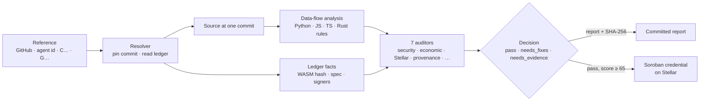
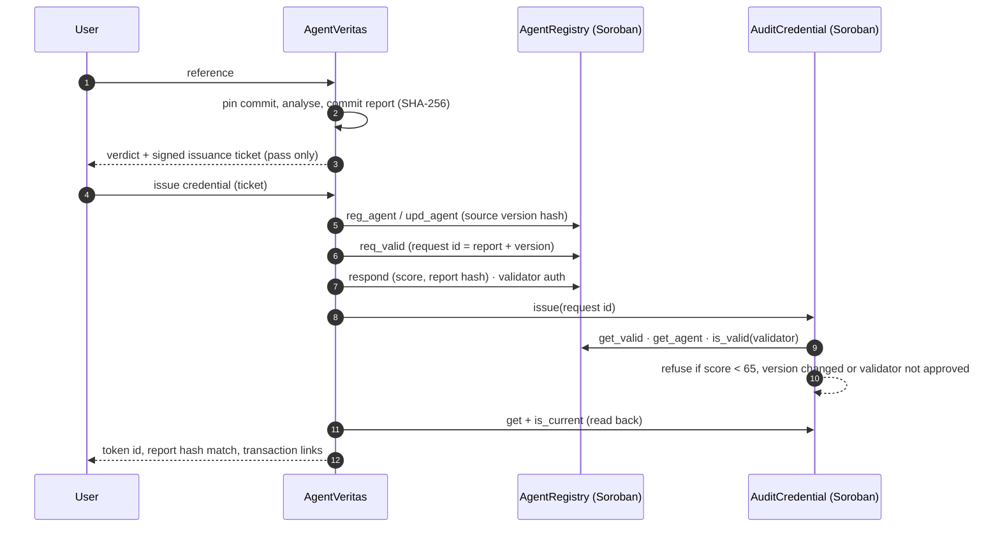

<p align="center">
  
</p>

<h1 align="center">AgentVeritas</h1>

<p align="center">
  <strong>Paste an AI agent's code or Stellar address. Find out whether it is safe to give it the keys, and get the answer recorded on Stellar.</strong>
</p>

<p align="center">
  <a href="https://agentveritas-stellar.vercel.app"></a>
  
  
  <a href="https://github.com/furkan3152/agentveritas-stellar/actions/workflows/verify.yml"></a>
  
  
</p>

---

## The demo

**[agentveritas-stellar.vercel.app](https://agentveritas-stellar.vercel.app)**: one box, one button.

1. **Paste** a GitHub repository (or one folder of it), an AgentRegistry agent id, a `C…` contract or a `G…` account.
2. **Read the verdict.** AgentVeritas pins the exact commit, traces what the model can make the code do, and commits a report with a SHA-256 hash.
3. **Issue the credential.** If the audit passes, the report hash and score are written to the AgentVeritas registry on Stellar testnet. The Soroban credential contract then issues a non-transferable token bound to that report, and the page reads it back from the ledger.

| An unsafe agent: refused | The same agent, fixed: credentialed on Stellar |
|---|---|
|  |  |

Both agents are in [`examples/demo`](examples/demo). They are the same MCP treasury agent:
- **Unsafe:** the model chooses the payment recipient, the amount and the URL to fetch.
- **Safe:** recipients come from a fixed table, amounts are capped in the schema, and invoices come from one host.

## Three proofs

| | Proof | Where to check |
|---|---|---|
| **1** | **Checked against real code.** 12 open-source Stellar agents were audited. Every one of the 199 findings was checked by hand against the source: 161 true, 32 partly true, 5 false, 1 unverifiable. The false positives found this way were fixed and turned into regression tests. | [Analysis model and measurements](docs/ANALYSIS_MODEL.md) |
| **2** | **Every credential is on chain.** The demo registry and credential contracts run on testnet. A credential shows the report hash and score the validator wrote, and anyone can read it back. | Registry [`CBIZOE…JZ6W`](https://stellar.expert/explorer/testnet/contract/CBIZOECNI22Y6RXANQWS7SYL2QGV2ZX2QZ4CS3GOOETFJ66SIN6YJZ6W) · Credential [`CBBTOB…O4R5`](https://stellar.expert/explorer/testnet/contract/CBBTOBL6XTLWYPT5GSVUA3JWNQMVMT4DGGHEGZ4NHC3V4SLXKP5AO4R5) · [manifest](deployments/demo-testnet.json) |
| **3** | **The contracts enforce the rules, not the UI.** The credential contract refuses a score below 65, a validator the registry did not approve, and a source version that changed after the audit. A separate agent-account contract enforces session spending limits: a forbidden recipient, an over-budget transfer and a revoked key were all rejected on testnet. | [Credential contract](contracts/audit-credential/src/lib.rs) · [agent-account evidence](deployments/agent-account-testnet-2026-10-15.json) |

---

## How it works



**The code decides what the agent can do, not the claims.** Each Python, JavaScript and TypeScript file is parsed into a syntax tree (nothing is executed). Untrusted input is then followed across files:
- **Untrusted sources:** model tool arguments, HTTP requests, chain data and the caller.
- **Sinks:** signing, payments, account authority, contract calls, shell, network, files and logs.

A path is cleared only by a control that **fails closed**: an allowlist, an upper bound, a confined path, a pinned network destination or an approval. A spend limit that the code does not enforce is reported, not credited.

**The score is itemised.** Each finding costs risk points: its severity, times its evidence grade, times its confidence, times how many places it affects. Restatements of one root cause count once. The score is `100 × e^(−points/100)`, so small problems cost about a point each and serious ones stay ordered instead of all reaching 0. Every report shows the calculation under "Why this score?". [Details](docs/ANALYSIS_MODEL.md#how-the-score-is-computed-policy-2026-10-163).

**One decision rule** drives the demo, the full Studio and the credential:
- `needs_fixes`: an actionable risk exists.
- `needs_evidence`: no risk was found, but part of the agent could not be reviewed.
- `pass`: no actionable risk, and the code, tools and instructions were all reviewed.

A paid **deep review with Claude** can be run on top of the rules. Its findings must quote real lines, and it can never remove a rule finding.

### The credential, step by step



---

## Stellar-native, end to end

| Layer | What AgentVeritas uses | Why it matters |
|---|---|---|
| **Soroban contracts** | `AgentRegistry`, `AuditCredential`, `AuditEscrow`, `AgentAccount` (Rust, `soroban-sdk`) | Identity, validation, credentials, settlement and bounded agent authority are enforced by contracts, not by a server. |
| **Authorization** | `require_auth` on owners, requesters and validators; `__check_auth` custom account with session keys | Only the approved validator can complete a validation; an agent session key cannot exceed its recipient or budget limits. |
| **Credentials** | Non-transferable, revocable, expiring; bound to agent version, metadata hash, endpoint hash and report hash; `is_current` | A changed agent invalidates its old credential; a report cannot be swapped after issuance. |
| **Settlement** | Stellar Asset Contract (SEP-41) in `AuditEscrow`, registry-bound | The audit fee is paid out only for the assigned validator's matching report and score. |
| **State lifetime** | Persistent storage with `extend_ttl` on every write and read | Records do not silently expire; the analyser also checks this in audited contracts. |
| **Ledger reads** | RPC `getLedgerEntries`: contract instance, WASM code (hash recomputed), `contractspecv0` (SEP-48) and `contractmetav0` (SEP-46), SAC detection | A `C…` agent is identified from the code that actually runs, not from a label. |
| **Account authority** | Horizon: signers, thresholds, flags, home domain | Shows who else can move an agent's funds. |
| **Ownership** | SEP-53 signed-message proof for `G…` accounts | Separates "this agent" from "someone who claims it". |
| **Stellar-specific analysis** | `Operation.payment` and other operations, `authorizeEntry`, `signTransaction`, `submitTransaction`, x402 on Stellar, SEP-10/45 boundaries, Horizon/RPC success checks, secret-seed detection, Freighter/Wallets Kit as human approval | The rules know what is dangerous on Stellar specifically. |
| **Discovery** | `/.well-known/stellar.toml` (SEP-1) | Service metadata for wallets and directories. |

## What a reference can be

| Reference | What is read | Can it pass? |
|---|---|---|
| GitHub repository or folder | Source pinned to a commit | Yes, on its code |
| AgentRegistry agent id (64 hex) | Registry record; card checked against its on-chain hash | Yes, when the card names the source |
| Contract `C…` | WASM, spec and metadata from the ledger; GitHub build attestation if present | Only with source |
| Account `G…` | Signers, thresholds, flags | No: authority facts only |
| Endpoint only | Nothing about its code | No |

An agent whose code cannot be read cannot be shown to be safe, so it cannot pass.

---

## Run it yourself

```bash
python3 -m venv .venv && .venv/bin/pip install -r requirements.txt

# Audit anything from the command line
.venv/bin/python scripts/audit_agent.py https://github.com/owner/repo --no-deep

# Local server: demo at /, full Studio at /studio
.venv/bin/uvicorn app:app --port 8000

# Tests
.venv/bin/python -m pytest -q
cargo test --workspace
```

To issue credentials from your own deployment, first run `scripts/deploy_demo_testnet.py`. It deploys a fresh registry and credential contract on testnet, and the operator key stays in the gitignored `data/` folder. Then set `DEMO_OPERATOR_SECRET` in the server environment.

## Limits, stated plainly

- The analysis is **static**: it reads code and does not run it. Logic flaws that are not a flow from input to a sink are left to the deep review.
- Chain rules are **Stellar-specific**. EVM and Solana value-movement checks are left to the deep review.
- The demo runs **on testnet**. One operator is both the demo registry's admin and its validator, and agent ownership is not verified in the demo.
- A pass means no actionable risk was found in what was reviewed. **It is not a guarantee of safety.**

## Repository

```text
backend/app/swarm/      analysers: codeflow.py (Python), jsflow.py (JS/TS), 7 auditors, policy
backend/app/services/   resolver, repository audit, deep review, demo flow, orders
backend/app/stellar/    ledger reads, authority, ownership (SEP-53), auth inspection
contracts/              Soroban: agent-registry, audit-credential, audit-escrow, agent-account
frontend/               demo (/), Studio (/studio)
examples/demo/          unsafe and safe treasury agents used by the demo
deployments/            testnet manifests and transaction evidence
docs/                   analysis model, threat model, architecture decisions
```

**Further reading:**
- [Analysis model and measured results](docs/ANALYSIS_MODEL.md)
- [Threat model](docs/THREAT_MODEL.md)
- [Stellar architecture decision](docs/STELLAR_ARCHITECTURE_DECISION.md)
- [Instawards sprint](docs/INSTAWARDS_SPRINT.md)
- [Project details and earlier pilots](docs/PROJECT_DETAILS.md)

[Contributing](CONTRIBUTING.md) · [Security policy](SECURITY.md) · [Apache 2.0](LICENSE)
