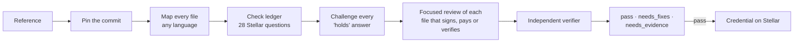

<p align="center">
  
</p>

<h1 align="center">touchmark</h1>

<p align="center">
  <strong>Security audits for AI agents that hold Stellar authority.</strong><br>
  Touchmark reads an agent's code in any language, checks it against Stellar-specific criteria, has a second
  model re-check every finding, and records a passing result on Stellar as a non-transferable credential.
</p>

<p align="center">
  <a href="https://touchmark-stellar.vercel.app"></a>
  
  <a href="https://github.com/furkan3152/Touchmark_agent/actions/workflows/verify.yml"></a>
  
</p>

<p align="center">
  <a href="public/media/touchmark-how-to.mp4"></a><br>
  <sub>▶ <a href="public/media/touchmark-how-to.mp4">How to use Touchmark</a> (2 min)</sub>
</p>

## Why Stellar needs this

AI agents on Stellar now hold keys, sign XDR, pay x402 and MPP invoices, authenticate with SEP-10 and drive
Soroban contracts. The defects that lose money there are Stellar-specific: a fee bump that lets a payment land
twice, an asset matched by code without its issuer, a path payment credited with the amount sent instead of the
amount received, a SEP-10 verifier that counts the server's own signature, a delegated `__check_auth` signer
satisfied by the invoker. General code scanners do not know these rules. Touchmark is built around them, and
gives the ecosystem a shared, on-chain answer to one question: *has someone checked this agent before it gets
keys?*

## Measured on real Stellar defects

Every case is a security defect that maintainers **fixed upstream** in a public Stellar repository. The audit runs
on the vulnerable commit through the public demo, exactly as a user would, and must cite the defective lines
(within 10 lines). Ground truth is the maintainers' fix, not our opinion.

| Set | Repositories | Detected |
|---|---|---|
| **Held-out: kept out of development** | stellar-disbursement-platform, stellar/go, java-stellar-anchor-sdk, Blend, Soroswap, soroban-examples, OpenZeppelin stellar-contracts, Reflector, js-stellar-sdk, typescript-wallet-sdk, django-polaris | **20 of 22** |
| Development: used to find and fix weaknesses | stellar-mpp-sdk, x402-stellar, asgcard, passkey-kit, OpenZeppelin stellar-contracts, one-way-channel, stellar-disbursement-platform, django-polaris, soneso | 11 of 16 |

- **On the fixed commits** of the eight most severe held-out cases, 6 reports no longer flag the defect's lines; the
  other two flag a different issue next to them.
- Seven held-out cases are covered by lessons written with that set in view; on the other 15, **13 were detected**.
  Every caveat is listed with the results.
- **Cost:** about **$0.45 of model usage per audit** (Claude Haiku at medium effort, with prompt caching).
- Every case links the vulnerable and fixed commits, and every report is published, so each result can be checked
  line by line: **[research/benchmark/real](research/benchmark/real/README.md)**. Re-run any case with
  `run_live.py` and score it with `score_real.py`.

## Try it

**[touchmark-stellar.vercel.app](https://touchmark-stellar.vercel.app)**: paste a GitHub repository or folder
pinned to a commit, a `C…` contract, a `G…` account or a registry agent id, and tick the model review.

| An unsafe agent: not yet | The same agent, fixed: touchmarked on Stellar |
|---|---|
|  |  |

Each finding shows the line it cites and whether the second model confirmed it, plus a **check ledger** that
answers, question by question, what the code protects and what it does not. Fix, re-audit, and the owner signs
the credential in Freighter.

## How an audit works



1. **File map.** Every file is read and recorded with what it does: where it signs, pays, holds secrets or
   verifies signatures. Every claim quotes its line; a quote not in the source is dropped.
2. **Check ledger.** The same 28 Stellar questions are asked of every agent with the same capabilities, in four
   groups: value movement; signing, network and submission; access and secrets; model behaviour. *Holds* and
   *fails* must quote the deciding line.
3. **Challenge.** Each fund, signing or access check answered *holds* is re-examined by a pass whose only job is
   to find one path where it does not hold.
4. **Focused file review.** Each file that signs, pays, holds keys or verifies signed input gets its own review,
   with the Stellar criteria and the lessons learned from real defects that match what the file does. The model
   states each function's security invariants and checks them one by one.
5. **Verification.** A second model re-checks each finding at the cited line without seeing why it was raised.
   Severity is computed from facts (what is at risk, who can trigger it, which network, whether the code ships),
   not chosen by the model. Comments in the audited code never count as controls.

Data-flow rules for Python and JavaScript/TypeScript and pattern rules for Rust, Go and Solidity run alongside.
Details: [docs/ARCHITECTURE.md](docs/ARCHITECTURE.md).

## What it checks on Stellar

| Area | Examples |
|---|---|
| Payments | Destination, amount or asset chosen by the model, a request or a memo; caps and budgets that survive restarts; assets matched without issuer; amount received vs. sent; rounding in fees and shares |
| Signing | Foreign XDR, fee bumps and Soroban auth entries signed without inspecting them; raw bytes signed; missing timebounds |
| Submission | `PENDING` or a timeout treated as final; fee-bump re-wraps; retries that pay twice; failure paths that leave state stuck |
| Incoming payments, x402, MPP | Proofs not bound to payer, amount and request; verify without settle; replayable hashes; fee sponsorship without a budget |
| Web authentication | SEP-10/45 challenges signed unchecked; verification that accepts no client signature or counts the server's own |
| Soroban | `require_auth` coverage, `__check_auth` and delegated signers, implicit invoker authorization, upgrade authority, TTL |
| Accounts | Signers and thresholds read from Horizon; SEP-29 memo-required destinations; SEP-1 identity |
| Agent surface | Prompt injection reaching a privileged call, secrets returned to the model, cross-tenant lookups, unauthenticated routes |

## Declare your agent: `.tmark`

A `.tmark` at the repository root states what the agent may do: network, keys and what it signs, spending limits,
recipients, approval and tools. Touchmark holds the code to every claim; a declaration never closes a risk on its
own. **[Build one in the browser](https://touchmark-stellar.vercel.app/guide/tmark#builder)** from a template and
check it live, or start from your code:

```bash
python scripts/tmark.py init path/to/repo    # a valid draft from what the code can do
python scripts/tmark.py check path/to/repo   # lists every error
```

Reference: [docs/TMARK.md](docs/TMARK.md).

## The credential on Stellar

Soroban contracts, not the server, decide whether a credential exists and is still valid. The owner signs the
registration in their own wallet; only an approved validator can complete a validation; the credential binds the
report hash and the agent's version, so a changed agent is no longer current. Scores below 65 are refused;
credentials expire after at most 90 days, cannot be transferred and can be revoked; no contract is upgradeable.
Contracts: `agent-registry`, `audit-credential`, `audit-escrow`, and `agent-account`, a custom account that gives
an agent session keys limited by recipient, asset, per-call maximum and budget.

## Run it

```bash
python3 -m venv .venv && .venv/bin/pip install -r requirements.txt
.venv/bin/python scripts/audit_agent.py https://github.com/owner/repo --no-deep      # rules only, no key
ENABLE_DEEP_REVIEW=1 ENABLE_FINDING_VERIFICATION=1 ANTHROPIC_API_KEY=... \
  .venv/bin/python scripts/audit_agent.py <ref>                                       # full review
.venv/bin/uvicorn app:app --port 8000                                               # demo at /
.venv/bin/python -m pytest -q && cargo test --workspace
```

In CI, the composite action ([`action.yml`](action.yml)) runs the deterministic analysis on every push, validates
the `.tmark` and annotates the cited lines:

```yaml
- uses: furkan3152/Touchmark_agent@main   # pin a commit SHA in production
  with: { fail-on: needs_fixes, annotate: medium }
```

## Limits

- A pass means no actionable risk was found in the reviewed code, not that the agent is safe.
- The audit never executes the code it reviews. A testnet execution probe that reproduces fund and key findings
  in a disposable microVM is prototyped in [research/testnet-probe](research/testnet-probe).
- Testnet by default; mainnet needs `ALLOW_MAINNET`. The contracts have a self-assessed review and **no external
  audit yet**. Report vulnerabilities as described in [SECURITY.md](SECURITY.md).

[Architecture](docs/ARCHITECTURE.md) · [Evidence](docs/EVIDENCE.md) · [`.tmark`](docs/TMARK.md) · [Benchmark](research/benchmark/real/README.md) · [Deployments](deployments/README.md) · [Security](SECURITY.md) · [Contributing](CONTRIBUTING.md) · [Apache 2.0](LICENSE)

---

Built by Furkan Akdoğan ([@furkan3152](https://github.com/furkan3152)).
