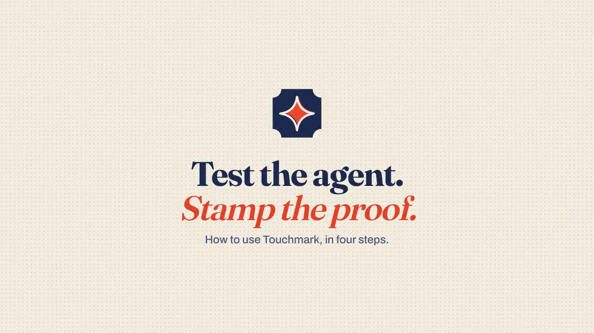
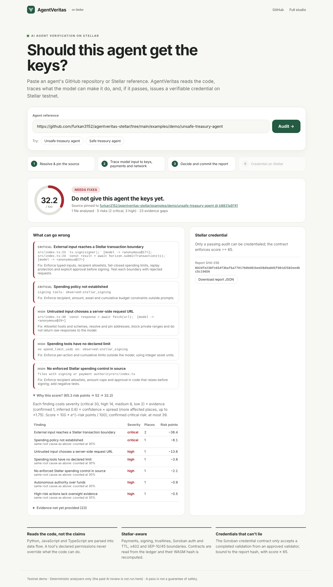
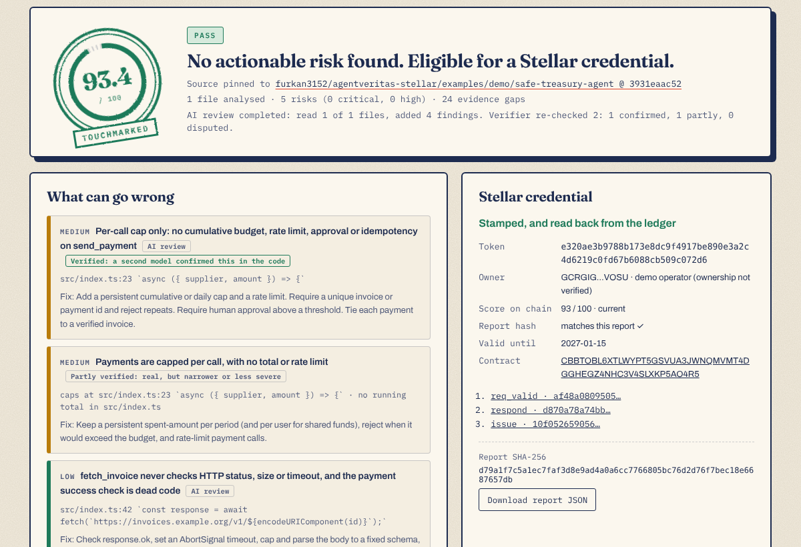
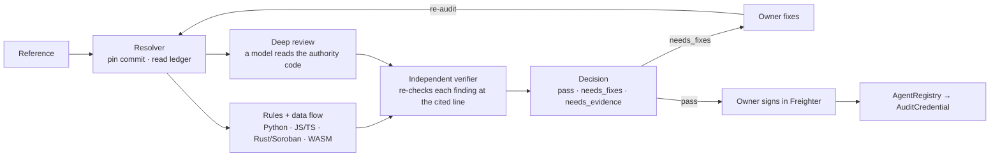

<p align="center">
  
</p>

<h1 align="center">touchmark</h1>

<p align="center">
  <strong>Test the agent. Stamp the proof.</strong><br>
  Before an AI agent gets your Stellar keys, Touchmark reads its code, has a second model check every finding,
  and stamps the result on Stellar, where anyone can verify it.
</p>

<p align="center">
  <a href="https://touchmark-stellar.vercel.app"></a>
  
  <a href="https://github.com/furkan3152/Touchmark_agent/actions/workflows/verify.yml"></a>
  
  
</p>

<p align="center">
  <a href="public/media/touchmark-how-to.mp4"></a><br>
  <sub>▶ <a href="public/media/touchmark-how-to.mp4">How to use Touchmark</a>: paste an agent, read the verdict, fix and re-test, stamp it on Stellar.</sub>
</p>

> A **touchmark** is the maker's mark struck into tested metal: a promise that someone checked it and stands behind it.
> Touchmark (formerly AgentVeritas) does the same for AI agents that hold Stellar keys.

---

## Contents

[The demo](#the-demo) · [Declare your agent: `.tmark`](#declare-your-agent-tmark) · [How a verdict is reached](#how-a-verdict-is-reached) ·
[What it checks on Stellar](#what-it-checks-on-stellar) · [Why the credential lives on Stellar](#why-the-credential-lives-on-stellar) ·
[Evidence](#evidence-and-what-is-not-yet-proven) · [Run it](#run-it) · [In CI](#in-ci) · [Security and limits](#security-and-limits)

## The demo

**[touchmark-stellar.vercel.app](https://touchmark-stellar.vercel.app)**: one box, one button.

1. **Paste** a GitHub repository or folder, an AgentRegistry agent id, a `C…` contract or a `G…` account.
2. **Read the verdict.** Touchmark pins the exact commit and traces the code from model input to keys, payments and
   the network. A model reviews the code and an independent second model re-checks each finding against the source.
   The report is committed with its SHA-256 hash, and "Why this score?" shows every point deducted.
3. **Fix and re-audit.** Paste the fixed commit; the page lists the risks that closed, the ones that remain and any new ones.
4. **Stamp it.** A passing report is written to the registry on Stellar testnet, and a Soroban contract issues a
   non-transferable credential bound to its hash and score. The page reads it back from the ledger and shows the
   credential card (SVG) with its token metadata.

| An unsafe agent: not yet | The same agent, fixed: touchmarked on Stellar |
|---|---|
|  |  |

Both are the same MCP treasury agent, in [`examples/demo`](examples/demo).
- **Unsafe version:** the model picks the recipient, the amount and the URL to fetch.
- **Safe version:**
  - recipients come from a fixed table;
  - each payment is capped and a daily budget is kept on disk;
  - every request id is paid at most once;
  - invoices come from one host.

## Declare your agent: `.tmark`

A `.tmark` file at the repository root states what the agent is and what it may do. It covers:
- its purpose and network;
- the keys it holds and what it signs;
- its spending limits, recipients and approval rule;
- its tools and the actions it must refuse.

Touchmark then checks the code against every claim:
- A claim the code keeps is shown as declared.
- A claim the code breaks is reported as a risk.
- A declaration never closes a risk on its own.

```bash
python scripts/tmark.py init path/to/repo    # writes .tmark, pre-filled from what the code can do
python scripts/tmark.py check path/to/repo   # lists every error; an invalid file is ignored, not half-used
```

The format is strict: one JSON object, no unknown fields, decimal amounts at Stellar precision, and assets as `XLM`,
`CODE:G…` or a `C…` token contract. The reference is [docs/TMARK.md](docs/TMARK.md) and the schema is
[tmark-v1.json](https://touchmark-stellar.vercel.app/schemas/tmark-v1.json).

To have the credential issued to your account, put your `G…` account in `owner.stellar_account`. You then sign the
registration in Freighter, and the credential goes to that account.

## How a verdict is reached



**Pattern rules propose; evidence decides.** Rules are tuned on agents someone has seen, so on new code they are
treated as leads, not verdicts:

- **Structural facts decide on their own.** These are:
  - a secret seed committed to the repository;
  - a dependency advisory matched to the installed version;
  - contract bytecode read from the ledger.
- **A high or critical pattern-rule finding blocks a pass only if the verifier confirms it** at the cited line.
  - If the verifier only partly confirms it, cannot verify it, or refutes it, the finding stays in the report as a
    medium risk. It is shown and scored, but cannot block a pass on its own.
  - Heuristic "candidate" rules are checked first. A candidate the verifier refutes becomes a zero-weight note that
    stays visible.
- **Model findings must quote a line that exists.** A claim whose quote does not match the source is rejected.
  Comments and strings in the audited code cannot talk the audit out of a risk.
- **Declaration checks judge only the code that ships.** Tests, e2e, sandbox, example, demo, script and docs paths
  are not the agent.

One decision rule is shared by the demo, the Studio, official audits and credential issuance:

| Decision | When |
|---|---|
| **needs_fixes** | Any of these: an actionable risk (critical or high, backed by evidence as above); a payment or security-control bypass the verifier confirmed, even at medium; accumulated risks pulling the score below 65 |
| **needs_evidence** | No actionable risk, but any of these: the deep review did not read every file holding the agent's authority; the code could not be fully analysed; a medium payment bypass was never verified |
| **pass** | No actionable risk, the full core surface reviewed, and the deep review complete |

**Rules alone never give a pass.** On agents no rule author had seen, pattern rules missed application-logic defects:
- replayable payment proofs;
- unauthenticated pay endpoints;
- budgets keyed on an address an attacker can rotate.

Rules alone once passed an agent that had three of them. A pass therefore needs the deep review to have read the code.

The components, the score formula, the contract state machine and the trust boundaries are described in
[docs/ARCHITECTURE.md](docs/ARCHITECTURE.md).

## What it checks on Stellar

| Area | Checks |
|---|---|
| Signing and payments | <ul><li>A model or a counterparty choosing the destination, amount, asset or memo.</li><li>Foreign transaction envelopes signed without inspection.</li><li>`authorizeEntry` and Soroban auth trees signed unread, and auth expiry windows.</li><li>Fee-bump and fee-sponsor paths.</li><li>Retries that can pay twice.</li></ul> |
| x402 and MPP | <ul><li>**Payer side:** spend controls and the requirements the payer accepts.</li><li>**Seller side:** verify-without-settle and unchecked settlement.</li><li>Payment hashes not bound to the request.</li><li>MPP replay stores, unsigned hash pushes and channel state.</li></ul> |
| Network and assets | <ul><li>Mainnet reachable from a testnet agent, and a network chosen by input or a counterparty.</li><li>The passphrase and the RPC endpoint configured apart.</li><li>Canonical USDC/XLM Stellar Asset Contract ids per network.</li><li>Asset code checked without its issuer, and a fallback to XLM.</li><li>StrKey checksums.</li></ul> |
| RPC and SDK | <ul><li>`PENDING` treated as final, and outcome statuses not checked.</li><li>Response fields misread.</li><li>Symbols removed from the SDKs, and transaction-meta versions.</li></ul> |
| Web authentication | SEP-10 and SEP-45 challenges signed without checking the server, home domain and operations |
| Soroban contracts (source) | <ul><li>`require_auth` coverage and auth arguments.</li><li>`__check_auth` and policy contracts.</li><li>Upgrade and initialisation authority.</li><li>Token moves bound to the right address.</li><li>Persistent-entry TTL.</li><li>Unchecked overflow.</li></ul> |
| Contracts on the ledger | <ul><li>WASM read and its hash recomputed; spec (SEP-48) and metadata (SEP-46).</li><li>A per-function call graph that finds unguarded upgrades and hidden functions.</li><li>CAP-85 external executable references, bound to the credential.</li></ul> |
| Accounts | Signers, thresholds and balances from the ledger; SEP-53 signed-message ownership proofs |
| Supply chain | <ul><li>Installed versions per package root (npm, pnpm, yarn, bun, Cargo, poetry, uv, Pipfile).</li><li>Stellar GHSA advisories and known-vulnerable wallet WASM hashes, matched on version and code condition.</li></ul> |

## Why the credential lives on Stellar

The credential is not a minted NFT with a label on it. The contracts decide whether it may exist and whether it is
still valid:

- **Authorization on every role.** Owner, requester, validator and revoker each need `require_auth`.
- **Owner-signed issuance.** When a repository names its owner, the owner's own wallet signs the registration and the
  credential is issued to that account. Neither the demo server nor anyone else can register the agent in the owner's
  name.
- **Validator authority.** Only a validator the registry approved can complete a validation, and only the one pinned
  when the request was made. Removing a validator invalidates every credential it issued.
- **Version–report binding.** A validation records the agent's version, metadata hash and endpoint hash with the report
  hash. If the agent changes, `is_current` fails.
- **Pass gate.** The credential contract refuses scores below 65.
- **Revocation and expiry.** The owner or issuer can revoke, and the first reason is permanent. Validity is at most
  90 days. Credentials cannot be transferred.
- **Spend-limited agent account.** A custom account (`__check_auth`) gives an agent session keys limited by recipient,
  asset, per-call maximum and cumulative budget. The owner can revoke them or shut the account down.
- **No upgrade authority.** No contract can be upgraded, not even by its admin.

## Evidence, and what is not yet proven

Every number below can be reproduced or is labelled self-verified. The full claims ledger and method are in
**[docs/EVIDENCE.md](docs/EVIDENCE.md)**.

| Claim | Status |
|---|---|
| Blind hand audits of 23 Stellar agents (13 seen during development, 10 never seen), two rounds: decisions match on 23 of 23. Of 281 hand-found issues Touchmark reports 246, and 93% of its own findings are real | Self-verified, with AI-assisted auditors and adjudicator. Aggregates only; the rows hold unpublished vulnerabilities |
| 22 agents never seen while building the rules were submitted through the demo API like users' repositories, each with an author-written `.tmark`. They were labelled blind. Model-review findings were 99% real. High rule and declaration findings that were not high fell from 45 of 52 to 1 of 5 after the fixes. Decisions matched on 14 of 22, and **no agent judged unsafe passed** | Self-verified. The remaining disagreements are mostly agents Touchmark held back that the labellers would pass, and deep reviews cut off by the demo's 250 s limit |
| A third held-out set of 10 agents: rules plus verifier matched the blind decision on 8 of 10 (rules alone: 6) | Self-verified. The rules missed 18 high application-logic defects, which is why a pass requires the deep review |
| The verifier agrees with hand labels: refutes 3 of 5 false findings and wrongly refutes 0 of 42 true ones (κ 0.65) | `scripts/calibrate_verifier.py`; self-verified |
| 46 labelled corpus agents (Python and TypeScript): 28 TP, 18 TN, 0 FP, 0 FN | `scripts/evaluate.py`. Written by the maintainers and used in development, so a regression measure |
| Contract rules enforced | 57 contract tests plus testnet transactions in [`deployments/`](deployments). **Not externally audited, not on mainnet** |
| Adoption | None yet: no outside users, no external audit, and private reports to maintainers not yet sent |

## Run it

Prerequisites: Python 3.12, and for the contracts Rust 1.91 with the `wasm32v1-none` target (pinned in
`rust-toolchain.toml`).

```bash
python3 -m venv .venv && .venv/bin/pip install -r requirements.txt
.venv/bin/python scripts/audit_agent.py https://github.com/owner/repo --no-deep   # rules only, no API key (never a pass)
ENABLE_DEEP_REVIEW=1 ENABLE_FINDING_VERIFICATION=1 \
  .venv/bin/python scripts/audit_agent.py <ref> --compare <fixed-ref>            # deep review + verifier + re-audit
.venv/bin/uvicorn app:app --port 8000                                            # demo at /, Studio at /studio
.venv/bin/python scripts/evaluate.py                                             # reproduce the corpus evaluation
.venv/bin/python -m pytest -q && cargo test --workspace                          # 1608 Python and 57 contract tests
```

Copy `.env.example` to `.env`. Everything is optional for a local run: with no keys the analysis is rules-only and
nothing is signed on-chain. The main settings are:
- `STELLAR_NETWORK`: `testnet`, `offline` or `mainnet`.
- `ALLOW_MAINNET`: required for mainnet, off by default.
- `ANTHROPIC_API_KEY` with `ENABLE_DEEP_REVIEW` and `ENABLE_FINDING_VERIFICATION`: the deep review and the verifier.
- `ENABLE_ONCHAIN_VERIFICATION`.
- The contract ids written by `scripts/deploy_demo_testnet.py`.

Never commit `.env` files or Stellar secret seeds.

| Layer | Technology |
|---|---|
| Analysis | Python 3.12, tree-sitter data flow (Python, JavaScript, TypeScript), Rust/Soroban source rules, a WASM profiler, lockfile resolution, seven auditors |
| Model review | Anthropic Claude: a deep review that must quote the code, and an independent verifier |
| API and UI | FastAPI, SQLAlchemy, a static HTML/CSS/JS front end (demo at `/`, Studio at `/studio`) |
| On-chain | Rust Soroban contracts (soroban-sdk 25.3.0) on Stellar testnet: `agent-registry`, `audit-credential`, `audit-escrow`, `agent-account`; `stellar-sdk` for Python, Freighter for owner signatures |
| Delivery | Vercel, Docker and Compose, a composite GitHub Action (`action.yml`) |

| Path | Contents |
|---|---|
| `backend/app/` | Resolver, auditors (`swarm/`), deep review and verifier (`services/`), Stellar clients, reporting, API |
| `backend/tests/` | Pytest suite |
| `contracts/` | Soroban contracts: registry, credential, escrow, spend-limited agent account |
| `frontend/` | Demo page and Studio |
| `scripts/` | Audit CLI, CI audit, `.tmark` tooling, evaluation and calibration, testnet deployment and verification |
| `examples/` | Safe and unsafe demo agents and the labelled evaluation corpus |
| `docs/` | [Architecture](docs/ARCHITECTURE.md), [Evidence](docs/EVIDENCE.md), [`.tmark` format](docs/TMARK.md) |
| `deployments/`, `research/` | Testnet deployment records and trial results |

## In CI

Add Touchmark to an agent's repository so every push and pull request is checked. The action:
- validates the `.tmark`;
- runs the deterministic analysis (no API key, no network, and the code is never run);
- annotates the cited lines and writes a job summary.

```yaml
# .github/workflows/touchmark.yml
on: [push, pull_request]
permissions:
  contents: read
jobs:
  touchmark:
    runs-on: ubuntu-latest
    steps:
      - uses: actions/checkout@11bd71901bbe5b1630ceea73d27597364c9af683  # v4
      - uses: furkan3152/Touchmark_agent@main   # pin a commit SHA in production
        with:
          fail-on: needs_fixes   # or never, to only report
          annotate: medium       # lowest severity shown on the code
```

Outputs:
- `decision`: `needs_fixes`, or `needs_evidence` when the rules find no actionable risk. A pass needs the full review.
- `score`.
- `tmark`: `valid`, `invalid` or `missing`.
- `report`: the full JSON.

The same check runs locally with `python scripts/ci_audit.py path/to/repo`.

## Security and limits

- **The audited code is never executed** by the analysis. The optional runtime sandbox is off by default.
- **Non-custodial credentials.** When a repository names its owner, the owner signs the registration in their own
  wallet.
- **Mainnet is opt-in** (`ALLOW_MAINNET=false` by default). The demo runs on testnet only, where one operator is both
  admin and validator.
- The contracts have a self-assessed security review in [docs/ARCHITECTURE.md](docs/ARCHITECTURE.md) and **have not been
  externally audited**. Report vulnerabilities as described in [SECURITY.md](SECURITY.md).
- **Coverage depends on the deep review.** On large repositories the demo's time limit can stop it before every
  authority file is read. The result is then `needs_evidence`, not a pass. With `scripts/audit_agent.py` the review time,
  turns and passes are set by `DEEP_REVIEW_TIMEOUT_SECONDS` (up to 900), `DEEP_REVIEW_MAX_TURNS` and `DEEP_REVIEW_PASSES`.
- **Ownership** means control of the repository and the named key, not legal identity.
- **A pass is not a certificate of safety.** It means that no actionable risk was found in the reviewed code.

[Architecture](docs/ARCHITECTURE.md) · [Evidence](docs/EVIDENCE.md) · [`.tmark`](docs/TMARK.md) · [Deployments](deployments/README.md) · [Security policy](SECURITY.md) · [Contributing](CONTRIBUTING.md) · [Apache 2.0](LICENSE)

---

Built by Furkan Akdogan ([@furkan3152](https://github.com/furkan3152)).
