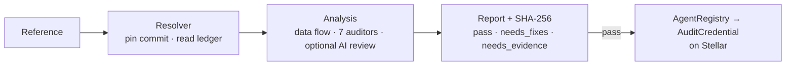

<p align="center">
  
</p>

<h1 align="center">AgentVeritas</h1>

<p align="center">
  <strong>Paste an AI agent's code or Stellar address. Find out whether it is safe to give it the keys, and get the answer recorded on Stellar.</strong>
</p>

<p align="center">
  <a href="https://agentveritas-stellar.vercel.app"></a>
  
  <a href="https://github.com/furkan3152/agentveritas-stellar/actions/workflows/verify.yml"></a>
  
  
</p>

---

## The demo

**[agentveritas-stellar.vercel.app](https://agentveritas-stellar.vercel.app)**: one box, one button.

1. **Paste** a GitHub repository or folder, an AgentRegistry agent id, a `C…` contract or a `G…` account.
2. **Read the verdict.** The exact commit is pinned, the code is traced from model input to keys, payments and the network, and a report is committed with its SHA-256 hash. "Why this score?" shows every point deducted.
3. **Issue the credential.** If the audit passes, a validator writes the report hash and score to the registry on Stellar testnet, a Soroban contract issues a credential bound to them, and the page reads it back from the ledger.

| An unsafe agent: refused | The same agent, fixed: credentialed on Stellar |
|---|---|
|  |  |

Both are the same MCP treasury agent, in [`examples/demo`](examples/demo). In the unsafe
one the model picks the recipient, the amount and the URL to fetch. In the safe one,
recipients come from a fixed table, amounts are capped and invoices come from one host.

## Why Stellar: the chain enforces the rules

The credential is not a minted NFT carrying a label. The contracts decide whether it may
exist and whether it is still valid:

- **Authorization.** `require_auth` is required on every role: owner, requester,
  validator and revoker.
- **Validator authority.** Only a validator the registry approved can complete a
  validation, and only the one pinned when the request was made. Removing a validator
  invalidates every credential it issued, immediately.
- **Version–report binding.** A validation records the agent's version, metadata hash and
  endpoint hash with the report hash. If the agent changes, the response, the issuance
  and `is_current` all fail.
- **Pass gate.** The credential contract refuses scores below 65.
- **Revocation and expiry.** The owner or issuer can revoke, and the first reason is
  permanent. Validity is at most 90 days. Credentials cannot be transferred.
- **Spend-limited agent account.** A custom account (`__check_auth`) gives an agent
  session keys limited by recipient, asset, per-call maximum and a cumulative budget,
  which the owner can revoke or shut down.
- **No upgrade authority.** No contract can be upgraded, not even by its admin.

Off-chain, the resolver reads contracts and accounts straight from the ledger. It reads
the WASM, recomputes its hash, and reads the spec (SEP-48) and metadata (SEP-46). It also
reads signers and thresholds, and uses SEP-53 for ownership proofs. The rules know
Stellar-specific dangers:
- payment and account operations, `authorizeEntry`, foreign envelope signing and x402;
- Soroban `require_auth` and TTL gaps;
- SEP-10/45 boundaries;
- unchecked transaction success.

## Evidence, and what is not yet proven

| Claim | Status |
|---|---|
| 46 labelled agents (Python + TS): 28 TP, 18 TN, 0 FP, 0 FN | Reproducible with `scripts/evaluate.py`. Written by us and used in development, so this is a regression measure. |
| 199 findings on 12 open-source Stellar agents checked by hand: 161 true, 32 partly true, 5 false | Self-verified with one annotator; recall unknown. The dataset is hash-committed now and published after disclosure. |
| Contract rules enforced | 57 contract tests plus testnet transactions. **Not externally audited, not on mainnet.** |
| Adoption | None yet: no outside users, and not yet indexed by ecosystem directories. |

The full claims ledger, the method and the **evidence milestones** this project is
working toward are in **[docs/EVIDENCE.md](docs/EVIDENCE.md)**:
- coordinated disclosure;
- an independent benchmark;
- an external contract audit;
- governance hardening;
- outside users.

## How it works



The components, the score formula, the contract state machine, the self-assessed
contract security review and the trust boundaries are described in
**[docs/ARCHITECTURE.md](docs/ARCHITECTURE.md)**.

## Run it

```bash
python3 -m venv .venv && .venv/bin/pip install -r requirements.txt
.venv/bin/python scripts/audit_agent.py https://github.com/owner/repo --no-deep   # audit from the CLI
.venv/bin/uvicorn app:app --port 8000                                            # demo at /, Studio at /studio
.venv/bin/python scripts/evaluate.py                                             # reproduce the evaluation
.venv/bin/python -m pytest -q && cargo test --workspace                          # tests
```

To issue credentials from your own deployment, run `scripts/deploy_demo_testnet.py`, then
set `DEMO_OPERATOR_SECRET`.

## Limits

- The analysis is **static**. Logic flaws that are not a flow from input to a sink are
  left to the AI review, and there is no runtime guarantee.
- Chain rules are **Stellar-specific**.
- The demo runs on **testnet**, where one operator is both admin and validator.
- A pass means no actionable risk was found in the reviewed code. **It is not a
  certificate of safety.**

[Architecture](docs/ARCHITECTURE.md) · [Evidence](docs/EVIDENCE.md) · [Deployments](deployments/README.md) · [Security policy](SECURITY.md) · [Contributing](CONTRIBUTING.md) · [Apache 2.0](LICENSE)
