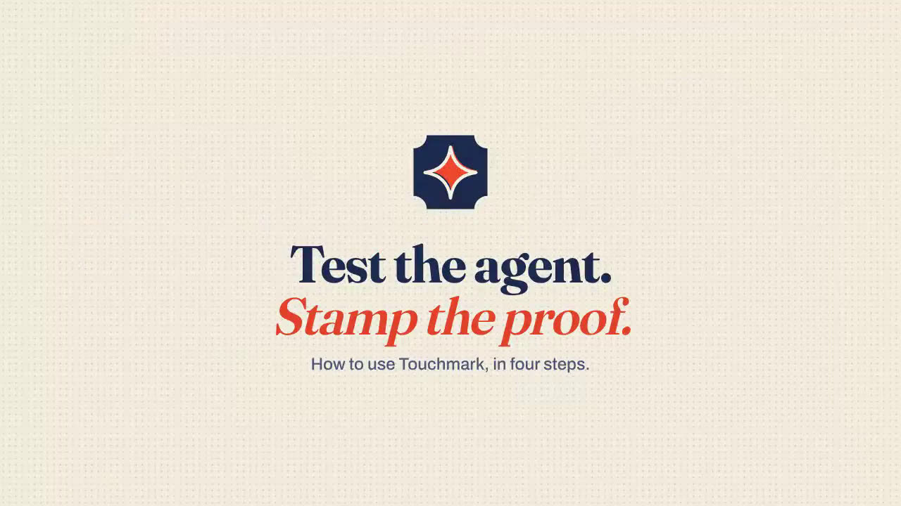
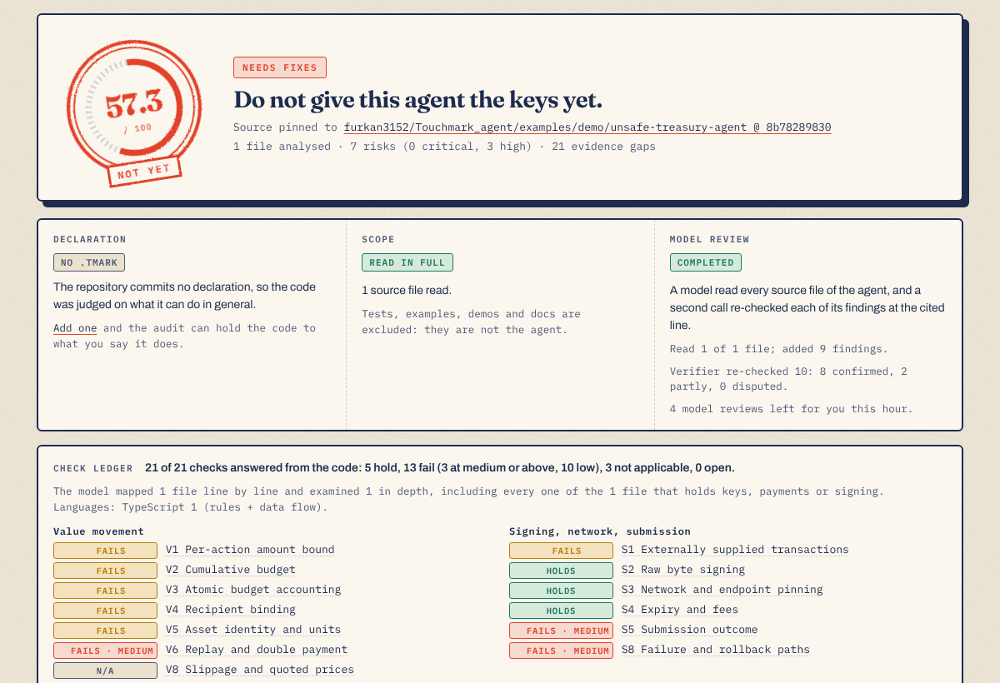
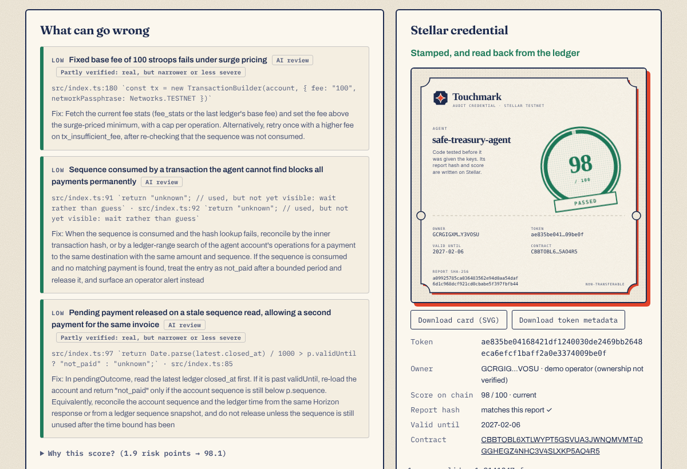
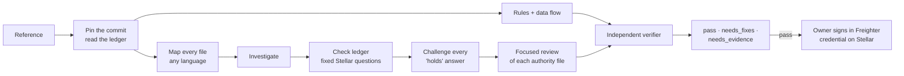

<p align="center">
  
</p>

<h1 align="center">touchmark</h1>

<p align="center">
  <strong>Test the agent. Stamp the proof.</strong><br>
  Before an AI agent gets Stellar keys, Touchmark reads every line of its code, checks it against a fixed list of
  Stellar-specific questions, has a second model re-check every finding, and stamps the result on Stellar.
</p>

<p align="center">
  <a href="https://touchmark-stellar.vercel.app"></a>
  
  <a href="https://github.com/furkan3152/Touchmark_agent/actions/workflows/verify.yml"></a>
  
  
</p>

<p align="center">
  <a href="public/media/touchmark-how-to.mp4"></a><br>
  <sub>▶ <a href="public/media/touchmark-how-to.mp4">How to use Touchmark</a>: paste an agent, read the verdict, fix and re-test, stamp it on Stellar.</sub>
</p>

> A **touchmark** is the maker's mark struck into tested metal: a promise that someone checked it and stands
> behind it. Touchmark does the same for AI agents, MCP servers and payment services that hold Stellar authority.

[Try it](#try-it) · [How an audit works](#how-an-audit-works) · [What it checks on Stellar](#what-it-checks-on-stellar) ·
[Measured accuracy](#measured-accuracy) · [`.tmark`](#declare-your-agent-tmark) · [The credential](#the-credential-on-stellar) ·
[Run it](#run-it) · [Limits](#security-and-limits)

## Try it

**[touchmark-stellar.vercel.app](https://touchmark-stellar.vercel.app)**

1. Paste a GitHub repository or folder (pinned to a commit), a `C…` contract, a `G…` account or a registry agent id.
2. Tick the model review. Touchmark reads the code and streams its progress; large repositories continue over
   several requests until every file is read. Only a spend cap can stop it early, and it says so.
3. Read the verdict: every finding with the line it cites and whether a second model confirmed it, plus a
   **check ledger** that shows, question by question, what the code protects and what it does not.
4. Fix, re-audit, and stamp a passing report on Stellar testnet as a non-transferable credential.

| An unsafe agent: not yet | The same agent, fixed: touchmarked on Stellar |
|---|---|
|  |  |

Both are the MCP treasury agent in [`examples/demo`](examples/demo). The fixed one takes recipients from a fixed
table, caps each payment, keeps a daily budget on disk, pays each request id once and fetches invoices from one host.

## How an audit works



1. **Rules and data flow** trace untrusted input (tool arguments, model output, HTTP requests, memos, fetched
   content) to signing, payments, contract calls, process execution and the network.
2. **File map.** Every file, in any language, is read by the model and recorded as a card: what it does, where it
   signs, pays, holds secrets or verifies signatures, and which controls it enforces. Each item quotes its line;
   a quote that is not in the source is dropped.
3. **Check ledger.** The same Stellar-specific questions are asked of every agent with the same capabilities
   (28 checks in four groups: value movement; signing, network and submission; access and secrets; model
   behaviour). Each is answered *holds*, *fails*, *not applicable* or *cannot determine*, and *holds* and *fails*
   must quote the deciding line. Each pass carries the written Stellar criteria for its checks.
4. **Challenge.** Every fund, signing or access check answered *holds* is re-examined by a pass whose only job is
   to find one path where it does not hold. A wrong *holds* is how a defect is missed.
5. **Focused file review.** Each file that signs, pays, holds keys or verifies signed input gets its own review:
   the model states the security invariants each function must enforce and checks them one by one.
6. **Verification and decision.** A second model re-checks each finding at the cited line without seeing why it
   was raised. Severity is computed from stated facts (what is at risk, who can trigger it, network, whether the
   code ships), not chosen by the model. Comments in the audited code never count as controls.

| Decision | When |
|---|---|
| `needs_fixes` | A confirmed critical or high risk, a confirmed payment or control bypass, or a score below 65 |
| `needs_evidence` | No actionable risk, but a file holding authority was not reviewed, or a key claim could not be verified |
| `pass` | No actionable risk and every file holding authority reviewed. Rules alone never give a pass |

Details, score formula and trust boundaries: [docs/ARCHITECTURE.md](docs/ARCHITECTURE.md).

## What it checks on Stellar

| Area | Examples |
|---|---|
| Payments | Destination, amount or asset chosen by the model, a request or a memo; amount bounds and cumulative budgets that survive restarts; assets matched by code without issuer; stroop and decimal confusion |
| Signing | Foreign XDR, fee bumps and Soroban auth entries signed without inspecting operations; raw bytes signed (an oracle for any transaction); missing timebounds |
| Network | Passphrase or Horizon/RPC URL chosen by the requester; a testnet agent that can reach mainnet |
| Submission | `PENDING` treated as final, unchecked result codes, retries that pay twice, failure paths that leave a channel or order stuck |
| Incoming payments and x402/MPP | Proofs not bound to payer, amount and request; verify without settle; replayable hashes; fee sponsorship without a budget |
| Web authentication | SEP-10/45 challenges signed unchecked, and verification that accepts a challenge with no client signature or counts the server's own |
| Soroban | `require_auth` coverage, `__check_auth` and delegated signers (implicit invoker authorization), upgrade authority, TTL, contract bytecode read from the ledger |
| Accounts | Signers and thresholds read from Horizon: an agent key that cannot pay alone is credited as an enforced control; SEP-29 memo-required destinations; SEP-1 identity |
| Agent surface | Prompt injection reaching a privileged call, secrets returned to the model, tools loaded at run time, cross-user state, unauthenticated routes and webhooks |

**Languages.** Data-flow rules for Python and JavaScript/TypeScript; pattern rules for Rust, Go and Solidity. The
model review reads every language, including Java, Kotlin, C#, Swift, PHP, Ruby and Dart, and the report says which
analyses covered each language.

## Measured accuracy

Measured on real defects, not on agents we wrote. Each case is a security defect that was **fixed upstream** in a
public Stellar repository; the audit runs on the vulnerable commit and must cite the defective lines.

| Set | Cases | Detected |
|---|---|---|
| Development set (used to find and fix weaknesses): stellar-mpp-sdk, x402-stellar, asgcard, passkey-kit, OpenZeppelin stellar-contracts, one-way-channel, stellar-agent-wallet, stellar-disbursement-platform, django-polaris | 16 | 9 before the focused file review and the authentication check, **11** after |
| Held-out test set (never used to tune): disbursement platform, stellar/go, anchor platform, Blend, Soroswap, soroban-examples, Reflector, js-stellar-sdk, typescript-wallet-sdk and more | 22 | being measured; reported in [the benchmark](research/benchmark/real/README.md) |

On three public Stellar MCP servers, an independent re-read of every medium-or-higher finding judged 20 of 21 real.
On six small agents in six languages with planted defects and decoys, the audit found the planted defects and
flagged no decoy as a defect. Earlier hand-audit studies are in [docs/EVIDENCE.md](docs/EVIDENCE.md). The numbers
are self-measured; there is no external audit yet.

A **testnet execution probe** is prototyped in [`research/testnet-probe`](research/testnet-probe): the agent runs in a
disposable microVM that can reach only testnet, its tools are called directly with fresh friendbot-funded accounts,
and the outcome is read from Horizon. It reproduced an unbounded payment and a leaked seed on a public MCP server.
Only fund and key defects are reproduced; code-execution defects are reported, never triggered.

## Declare your agent: `.tmark`

A `.tmark` at the repository root states what the agent is and may do: purpose and network, keys and what it signs,
spending limits, recipients and approval, tools, and the account it acts from. Touchmark checks the code against
every claim; a declaration never closes a risk on its own, and an honest "no limit" is not penalised.

```bash
python scripts/tmark.py init path/to/repo    # a valid draft from what the code can do
python scripts/tmark.py check path/to/repo   # lists every error
```

Reference: [docs/TMARK.md](docs/TMARK.md) · schema: [tmark-v1.json](https://touchmark-stellar.vercel.app/schemas/tmark-v1.json).
Name `authority.agent_account` and Touchmark reads its signers and thresholds; put your account in
`owner.stellar_account` to receive the credential.

## The credential on Stellar

The Soroban contracts, not the server, decide whether a credential may exist and whether it is still valid:
owner, requester, validator and revoker each need `require_auth`; the owner signs the registration in their own
wallet; only an approved validator, pinned at request time, can complete a validation; the validation binds the
report hash and the agent's version, metadata and endpoint, so a changed agent is no longer current; scores below
65 are refused; credentials last at most 90 days, cannot be transferred and can be revoked; no contract can be
upgraded. Contracts: `agent-registry`, `audit-credential`, `audit-escrow`, and `agent-account`, a custom account
that gives an agent session keys limited by recipient, asset, per-call maximum and budget.

## Run it

Python 3.12; Rust 1.91 with `wasm32v1-none` for the contracts.

```bash
python3 -m venv .venv && .venv/bin/pip install -r requirements.txt
.venv/bin/python scripts/audit_agent.py https://github.com/owner/repo --no-deep      # rules only, no key
ENABLE_DEEP_REVIEW=1 ENABLE_FINDING_VERIFICATION=1 ANTHROPIC_API_KEY=... \
  .venv/bin/python scripts/audit_agent.py <ref>                                       # full review
.venv/bin/uvicorn app:app --port 8000                                               # demo at /, Studio at /studio
.venv/bin/python -m pytest -q && cargo test --workspace
```

Settings are in `.env.example` (never commit `.env` or secret seeds). In CI, the composite action
([`action.yml`](action.yml)) runs the deterministic analysis on every push, validates the `.tmark` and annotates
the cited lines:

```yaml
- uses: furkan3152/Touchmark_agent@main   # pin a commit SHA in production
  with: { fail-on: needs_fixes, annotate: medium }
```

## Security and limits

- The audit never executes the code it reviews; the testnet probe is a separate, opt-in prototype.
- Testnet only by default; mainnet needs `ALLOW_MAINNET`. The demo's operator is also its validator.
- Model reviews on the demo need consent and are limited per client, per hour and by a daily cost cap. Cost is
  never shown publicly.
- The contracts have a self-assessed review in [docs/ARCHITECTURE.md](docs/ARCHITECTURE.md) and **no external audit**.
  Report vulnerabilities as described in [SECURITY.md](SECURITY.md).
- A pass is not a certificate of safety: it means no actionable risk was found in the reviewed code.

[Architecture](docs/ARCHITECTURE.md) · [Evidence](docs/EVIDENCE.md) · [`.tmark`](docs/TMARK.md) · [Benchmarks](research/benchmark/real/README.md) · [Deployments](deployments/README.md) · [Security](SECURITY.md) · [Contributing](CONTRIBUTING.md) · [Apache 2.0](LICENSE)

---

Built by Furkan Akdogan ([@furkan3152](https://github.com/furkan3152)).
