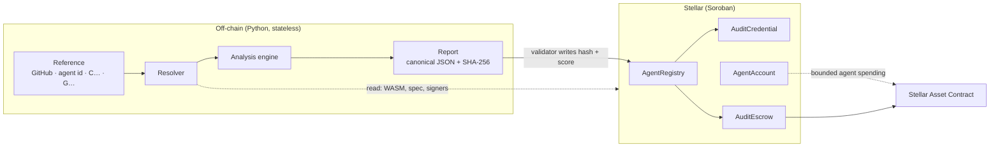

# Architecture

AgentVeritas answers one question about an AI agent: **is it safe to give it authority
over funds, and can that answer be checked later?** It has two halves. An off-chain
analysis engine reads the agent's code and produces a committed report. The on-chain
contracts on Stellar record that report and enforce what a passing report allows.



## 1. Resolver

`backend/app/services/agent_resolver.py` turns any reference into source pinned to a
commit and the facts the ledger proves. It reads the ledger only and never signs.

| Reference | Read | Binding of source to the agent |
|---|---|---|
| GitHub repo or folder | Commit resolved over git smart-HTTP | `user_supplied` |
| AgentRegistry id | Registry record; card fetched and compared with `meta_hash`; endpoint compared with `end_hash` | `registry_card` |
| Contract `C…` | `getLedgerEntries`: instance, WASM (SHA-256 recomputed), `contractspecv0`, `contractmetav0`; GitHub build attestation for the WASM hash | `attested_build` or `wasm_metadata` |
| Account `G…` | Horizon: signers, thresholds, flags, home domain | none (authority facts only) |

Without bound source, the report records the blocking gap `onchain-source-unbound`, and
the agent cannot pass.

## 2. Analysis engine

Nothing submitted is imported or executed.

1. **Selection** (`repo_audit.select_repository`). Up to 1,500 files or 12 MB are
   selected, with files that decide authority (auth, routing, middleware, policy,
   keys, webhooks) taken first. Source left out keeps the analysis-incomplete gap open.
2. **Data flow.** `swarm/codeflow.py` handles Python (AST) and `swarm/jsflow.py` handles
   JavaScript and TypeScript (tree-sitter). The analysis is project-wide, follows imports
   and is context-insensitive.
   - **Sources:** model tool arguments and model output; HTTP requests and fetched
     content; chain data (memos, payments); the caller.
   - **Sinks:** signing and submission; payment and account operations; contract
     invocation; authorization entries; x402 paying clients; process and code execution;
     server-side fetch; file paths; logs; model prompts.
   - **Controls** count only when they fail closed: allowlists and fixed tables, upper
     bounds, path containment, address-pinned network destinations, approvals, and
     transaction inspection. Wallet prompts (Freighter, Wallet Standard, EIP-1193) and
     signers supplied by the caller are delegated authority, not the agent's own.
   - **Controls that only look like controls** are reported, because a request the model
     refuses plainly passes when reworded: an approval flag the requester sets
     (`security-path-forgeable-approval`), a payment rule stated only in the instructions
     (`security-policy-only-in-prompt`), a per-call cap with no running total
     (`security-per-call-cap-only`), and an RPC or Horizon URL the requester chooses
     (`security-path-untrusted-ledger-endpoint`). The AI review attacks each value-moving
     action with reworded, split and indirect requests, cross-user access and replay.
3. **Auditors.** Seven dimensions: security, economic, Stellar-native, intent, compliance,
   reliability and provenance. Stellar-native covers Rust contract checks (`require_auth`
   paths, persistent TTL), payment success checks, SEP-10/45 boundaries and seed
   detection.
4. **Deep review (optional).** A Claude model reads the code with file and line tools.
   Each claim must quote a real line, and the model can add findings but never remove
   a rule finding.
5. **Independent verification** (`services/finding_verifier.py`, optional). A second
   model re-checks every medium-or-higher risk from source.
   - **Withheld context:** it sees only the claim and the lines it points to, not the
     reasoning that produced it.
   - **Verdicts:** confirmed, partial (real but narrower, latent or less severe), refuted
     or unverifiable.
   - **Quote gate:** every verdict except unverifiable must quote a real line, and a
     verdict whose quote is not in the file becomes unverifiable.
   - **Effect:** verification annotates each finding and adds an agreement rate to the
     report. It never changes the score or decision, so code comments cannot talk the
     audit out of a risk.
   - **Calibration:** `scripts/calibrate_verifier.py` measures it against hand-labelled
     findings (see [EVIDENCE.md](EVIDENCE.md)).
6. **Decision and score** (`swarm/policy.py`, `swarm/judge.py`).
   - **Decision:**
     - `needs_fixes`: an actionable high or critical risk.
     - `needs_evidence`: no risk, but code, tools and instructions were not all reviewed.
     - `pass`: neither of the above.
   - **Score:** each finding costs severity × evidence grade × confidence × spread;
     restatements of one root cause count 30%. The score is
     `100 × e^(−points/100)`, capped at 39 with a confirmed critical and at 64 with any
     other actionable risk. Evidence gaps never cost points.
   - **Breakdown:** the report carries the calculation in `result.score_breakdown`.
7. **Report.** The report is canonical JSON with a SHA-256 hash, and includes the
   resolution, source pin, findings, breakdown, coverage and verification.
8. **Declarations and ownership.** `agentveritas.json` at the audited commit can name the
   owner (`stellar_owner`) and declare the agent: `purpose`, `tools` (with
   `requires_signature`, `network_access`, `spend_limit_usdc`), `forbidden_goals`,
   `human_oversight`, `discloses_ai`. A Blueprint `veritas.json` adds its purpose and
   component map. Declarations close evidence gaps but never a risk: declared tools are
   reconciled with what the code can do, and a declared limit the code does not enforce is
   reported as `security-declared-limit-not-enforced`. With an owner named, the credential
   is issued to that account after it signs the registration in its own wallet.
9. **Re-audit** (`services/report_diff.py`). Two references, for example a commit and
   its fix, are audited and compared: closed, remaining and introduced risks, and the
   score change (`audit_agent.py --compare`, `POST /api/v1/demo/compare`).

## 3. On-chain layer

No contract has an upgrade function: deployed code cannot be changed by anyone,
including the admin. A fix ships as a new deployment.

```mermaid
stateDiagram-v2
    [*] --> Registered: reg_agent (owner auth)
    Registered --> Requested: req_valid (requester auth, approved validator pinned)
    Requested --> Complete: respond (that validator only, once; version unchanged)
    Complete --> Issued: issue (score ≥ 65, validator still approved, version unchanged)
    Issued --> NotCurrent: expiry · owner/issuer revoke · validator removed · agent version changed or deactivated
    NotCurrent --> [*]
```



| Contract | Enforces |
|---|---|
| **AgentRegistry** | Owner-authorized, versioned agents. An admin allowlist of validators. The validator is pinned when a request is created and responds once, with a score, report URI and non-zero report hash, and only while the agent version, metadata hash and endpoint hash are unchanged. Reviewers score once each. |
| **AuditCredential** | Issues one non-transferable credential per completed validation. It refuses scores below 65, a validator no longer approved, and an agent changed since the request. Expiry is at most 90 days. The owner or issuer can revoke, and the first reason is permanent. `is_current` re-checks expiry, revocation, the validator's approval and the agent's current version on every read. |
| **AuditEscrow** | Settles in a Stellar Asset Contract (SEP-41) and is bound to a registry request. It pays out only for the assigned validator's matching report and score. Fees are capped and snapshotted at creation. Deadlines, refunds and a review window apply, and a dispute locks funds until the admin resolves it. |
| **AgentAccount** | A custom account (`__check_auth`) for an agent's session keys. It enforces allowed recipients and assets, a per-call maximum and a cumulative budget across calls and contexts, nonces, expiry, rotation, revocation, shutdown and owner-only recovery. |

All persistent entries extend their TTL on write and read; an archived entry makes the
read fail rather than return stale state.

### Contract security review (self-assessed)

| Concern | Current behaviour | Tests | Open |
|---|---|---|---|
| Validator onboarding | One registry admin key calls `set_valid` | `assigned_validator_cannot_be_replaced`, `constructor_prevents_initialization_takeover` | Admin is a single key with no rotation function. Plan: make the admin a Stellar multisig account (native thresholds), add an admin transfer function, and use a timelock for validator changes. |
| Validator revocation | `set_valid(false)` makes every credential that validator issued non-current at once | `expiry_and_validator_removal_fail_closed`, `disabled_validator_blocks_submit_and_complete_without_locking_refund` | — |
| Upgrade authority | None; the code is immutable | — | Bugs need a redeploy and a migration path |
| Replay | Request ids, credentials and reviews are unique; `respond` runs once; account nonces and session rotation | `reviewer_cannot_double_count`, `wrong_signature_payload_and_rotated_session_fail`, `real_sac_presigned_entries_fail_after_rotation_revocation_and_shutdown` | — |
| Front-running | Agent ids and request ids are chosen by the caller | — | An attacker can claim an id first. This cannot steal funds, but it can block (grief) a registration. Plan: derive ids in the contract from owner and nonce. |
| Stale or changed agent | Version and hash checks at respond, issue and `is_current`, and in escrow | `source_change_invalidates_and_prevents_stale_mint`, `version_change_blocks_create_fund_submit_and_complete` | — |
| TTL and state growth | Entries grow with use; the caller pays rent; TTL is extended on access | `state_lifetime_exceeds_sessions_and_missing_state_fails_closed` | No pruning of expired credentials; restoring archived entries is left to clients |
| Credential revocation | Owner or issuer; first reason permanent | `revocation_is_authorized_and_permanent`, `first_revocation_reason_cannot_be_overwritten` | — |
| Escrow edge cases | Deadlines, review window, disputes, role separation, fee snapshot | 24 escrow tests | Disputes are resolved by a single admin |

This review is the project's own. **No external audit has been done.** See
[EVIDENCE.md](EVIDENCE.md).

## 4. Trust boundaries

| Boundary | Control | Residual risk |
|---|---|---|
| Submitted code | Parsed only, never executed; size and complexity limits | Static analysis misses runtime behaviour and logic flaws |
| Repository fetch | Pinned commit; safe zip extraction (no symlinks, size cap) | A repository can differ from what is deployed; attestation narrows this for contracts |
| Model review | Line-quoted claims; cannot remove rule findings; isolated per request | Prompt injection in code comments; hallucinated claims are filtered, not eliminated |
| Demo issuance | Server-signed ticket over report hash, score, source and named owner; per-client limits | One operator is admin and validator on the demo registry |
| Ownership | `agentveritas.json` at the audited commit names the owner account. The owner signs the registry registration (`owner.require_auth`); the server accepts only that exact call from that account, with its signature | Shows control of the repository and of the key, not real-world identity. A fork can name its own owner, but its credential names the fork. Without the file, ownership is not verified and the credential goes to the operator. |
| Public API | Rate limits, CSP, no secrets in responses | Serverless instances keep limits per instance |

## 5. Deployment

The public site is a stateless FastAPI app on Vercel (`app.py`):
- `/` is the demo; `/studio` is the full Studio.
- `/api/v1/demo/*` audits a reference and issues credentials.

Configuration:

| Variable | Purpose |
|---|---|
| `DEMO_OPERATOR_SECRET` | Testnet key that admins the demo registry and acts as its validator. Created by `scripts/deploy_demo_testnet.py` and stored in gitignored `data/`. |
| `ANTHROPIC_AI_KEY` | With `ENABLE_DEEP_REVIEW` and `ENABLE_FINDING_VERIFICATION`, the demo adds the model review and verification: 5 audits per client and 60 overall per hour, stopped by a 250 s deadline (findings found so far are kept, and the page says the review stopped). Past the allowance, audits run the rules only. |
| `STELLAR_NETWORK`, `ALLOW_MAINNET` | Network selection. Mainnet stays off unless explicitly allowed. |
| `ADMIN_API_KEY` | Operator API on a persistent deployment (not exposed on Vercel). |

Other options are documented in `.env.example`.

```text
backend/app/services/   resolver, repo audit, deep review, demo flow
backend/app/swarm/      codeflow.py, jsflow.py, auditors, policy.py, judge.py
backend/app/stellar/    ledger reads, authority, SEP-53 ownership, auth-entry inspection
contracts/              agent-registry, audit-credential, audit-escrow, agent-account
scripts/                audit_agent.py, evaluate.py, deploy_demo_testnet.py
```
