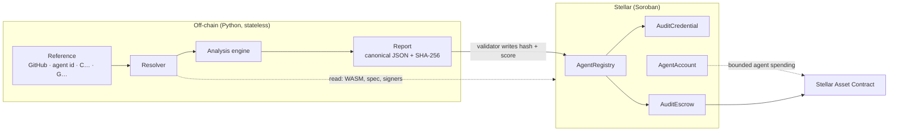

# Architecture

Touchmark answers one question about an AI agent: is it safe to give it authority
over funds, and can that answer be checked later? It has two halves. An off-chain
analysis engine reads the agent's code and produces a committed report. The on-chain
contracts on Stellar record that report and enforce what a passing report allows.



## 1. Resolver

`backend/app/services/agent_resolver.py` turns any reference into source pinned to a
commit and the facts the ledger proves. It reads the ledger only and never signs.

| Reference | Read | Binding of source to the agent |
|---|---|---|
| GitHub repo or folder | Commit resolved over git smart-HTTP | `user_supplied` |
| AgentRegistry id | Registry record; card fetched and compared with `meta_hash`; endpoint compared with `end_hash` | `registry_card` |
| Contract `C…` | `getLedgerEntries`: instance, WASM (SHA-256 recomputed), `contractspecv0`, `contractmetav0`; GitHub build attestation for the WASM hash | `attested_build` or `wasm_metadata` |
| Account `G…` | Horizon: signers, thresholds, flags, home domain | none (authority facts only) |

Without bound source, the report records the blocking gap
`stellar_native-onchain-source-unbound`, and the agent cannot pass.

## 2. Analysis engine

Nothing submitted is imported or executed.

1. **Selection** (`repo_audit.select_repository`). Up to 1,500 files or 12 MB are
   selected, with files that decide authority (auth, routing, middleware, policy,
   keys, webhooks) taken first. Source left out keeps the analysis-incomplete gap open.
   Dependencies and build output committed with the code (`node_modules`, `vendor`,
   `site-packages`, `dist-packages`, `dist`, `build`, `target`) are not the agent and are
   skipped (`repo_audit.SKIP_DIRS`). Agent instructions (`SKILL.md`, `AGENTS.md`, prompt files)
   are read too, and in a skill bundle the Markdown guides beside a `SKILL.md`: the hardening
   checks (hidden characters, poisoned instructions, hidden loaders) run over all of them.
   A hidden or obfuscated loader (code pushed past the visible width, or a long obfuscated
   line) is a finding, critical when a package script or build tool config runs it.
2. **Data flow.** `swarm/codeflow.py` handles Python (AST) and `swarm/jsflow.py` handles
   JavaScript and TypeScript (tree-sitter). The analysis is project-wide, follows imports
   and is context-insensitive.
   - Sources: model tool arguments and model output; HTTP requests and fetched
     content; chain data (memos, payments); the caller.
   - Sinks: signing and submission; payment and account operations; contract
     invocation; authorization entries; x402 paying clients; process and code execution;
     server-side fetch; file paths; logs; model prompts.
   - Controls count only when they fail closed: allowlists and fixed tables, upper
     bounds, path containment, address-pinned network destinations, approvals, and
     transaction inspection. Wallet prompts (Freighter, Wallet Standard, EIP-1193) and
     signers supplied by the caller are delegated authority, not the agent's own.
   - Controls that only look like controls are reported, because a request the model
     refuses plainly passes when reworded: an approval flag the requester sets
     (`security-path-forgeable-approval`), a payment rule stated only in the instructions
     (`security-policy-only-in-prompt`), a per-call cap with no running total
     (`security-per-call-cap-only`), and an RPC or Horizon URL the requester chooses
     (`security-path-untrusted-ledger-endpoint`). The model review attacks each value-moving
     action with reworded, split and indirect requests, cross-user access and replay.
   - Beyond the payment path (`swarm/hardening.py` and the flow engines):
     - the agent key signing raw bytes the requester picks (`security-path-key-signs-arbitrary-bytes`).
       A hash, JSON or fixed-prefix preimage is not an oracle;
     - SQL built from input (`security-path-untrusted-to-sql`);
     - unsafe deserialization of fetched data, reported as command execution;
     - a requester-chosen network passphrase (`security-path-untrusted-ledger-endpoint`);
     - a requester-chosen path-payment route (`security-path-untrusted-conversion-route`);
     - poisoned tool descriptions (`security-tool-description-injection`);
     - invisible Unicode (`security-hidden-unicode`);
     - committed API keys, reported with redacted locations only (`security-committed-credential`);
     - signed transactions that never expire (`security-transaction-never-expires`);
     - plain-HTTP Horizon/RPC (`security-ledger-endpoint-plain-http`);
     - retries that rebuild the transaction and can pay twice (`security-retry-may-pay-twice`);
     - incoming payments checked by asset code without the issuer (`security-asset-checked-by-code-only`);
     - Soroban crates without `overflow-checks` (`security-soroban-overflow-unchecked`).
3. **Auditors.** Seven dimensions: security, economic, Stellar-native, intent, compliance,
   reliability and provenance. Stellar-native covers Rust contract checks (`require_auth`
   paths, persistent TTL), payment success checks, SEP-10/45 boundaries and seed
   detection.
4. **Model review** (optional: needs the visitor's consent and an API key). A Claude
   model reads the code with file and line tools; see
   [Model review](#model-review-file-map-and-check-ledger) below. Each claim must quote
   a real line, and the model can add findings but never remove a rule finding.
5. **Verifier** (`services/finding_verifier.py`; on by default, needs an API key). A
   separate, independent model call (the verifier model; by default the review's model) re-checks the medium-or-higher risks from source, most
   severe first and at most 60 per audit (`finding_verifier.selectable`).
   - Withheld context: it sees only the claim and the lines it points to, not the
     reasoning that produced it.
   - Verdicts: confirmed, partial (real but narrower, latent or less severe), refuted
     or unverifiable.
   - Quote gate: every verdict except unverifiable must quote a real line, and a
     verdict whose quote is not in the file becomes unverifiable. A verdict that quotes
     a code comment is ignored, so comments cannot talk the audit out of a risk.
   - Effect (`AuditSwarm._apply_disputes`): each verdict is recorded on its finding and
     the report adds an agreement rate. Verdicts then change findings within fixed limits:
     - a pattern-rule finding refuted at a quoted code line becomes a disputed note at
       no weight; a candidate rule (`policy.CANDIDATE_RULES`) refuted or rated as no
       issue is dismissed the same way. Both stay visible in the report;
     - fund-control rules and structural facts (a committed seed, a dependency advisory,
       on-chain bytecode) stay risks when refuted: lowered one level, and fund-control
       rules to at most medium;
     - a high or critical pattern-rule finding that the verifier rates partial or
       unverifiable is capped at medium (structural facts excepted);
     - a confirmed or partial verdict with a lower severity applies that severity to rule
       and model findings alike, except that a critical model finding goes down one level
       only, to high (still blocking a pass), rule and on-chain criticals keep theirs, and a
       fund, signing or access model finding keeps its severity at reduced weight;
     - a refuted model finding counts at reduced weight, and a refuted critical becomes high;
     - a finding the verifier could not check counts at reduced confidence.

     Model-review findings are never refuted away. Verdicts also feed the decision: a
     confirmed medium bypass blocks a pass, and an unchecked one holds it back (item 6).
   - Calibration: `scripts/calibrate_verifier.py` measures it against hand-labelled
     findings (see [EVIDENCE.md](EVIDENCE.md)).
6. **Decision and score** (`swarm/policy.py`, `swarm/judge.py`).
   - Decision (`policy.review_decision`):
     - `needs_fixes`: an actionable risk, or risks that together put the score below
       65. An actionable risk is a high or critical risk whose evidence is not simulated,
       or a medium bypass (a way around a payment or security control, or to funds,
       accounts or other users' data; `policy.payment_bypass`) that the verifier
       confirmed at the quoted line.
     - `needs_evidence`: no actionable risk, but code, tools and instructions were not
       all reviewed, a blocking evidence gap is open (`policy.BLOCKING_GAPS`, for example
       unbound on-chain source or an incomplete model review), or a medium bypass was
       never verified or could not be decided (`policy.unverified_bypasses`).
     - `pass`: none of the above.
   - Score: each finding costs severity weight (critical 30, high 14, medium 6, low 2) ×
     evidence grade (confirmed 1, for direct evidence such as a code match; inferred 0.6,
     for a missing defence) × confidence × scope (×1 for one cited place, rising on a log
     scale to ×1.75 for many). Findings are counted from the costliest down: a
     restatement of a root cause already counted costs 30% (`judge.ROOT_CAUSES`), a further
     model finding of a category already counted costs half (the same defect is often filed
     once per file or language), and a finding whose severity has already been counted n
     times costs 1/(1 + 0.25n). A model finding counts by how far the verifier upheld it:
     confirmed ×1, partly ×0.8, unchecked ×0.75. The
     score is `100 × e^(−points/100)`.
     With an actionable risk it is held under a ceiling, 39 when a critical risk has
     confirmed evidence and 64 otherwise; scores above ten points below the ceiling are
     compressed into the last ten (`judge.band_score`), so two risky agents still differ.
     Evidence gaps never cost points.
   - Breakdown: the report carries the calculation in `result.score_breakdown`.
7. **Report.** The report is canonical JSON with a SHA-256 hash, and includes the
   resolution, source pin, findings, breakdown, coverage and verification.
8. **Declarations and ownership.** A `.tmark` at the audited commit ([TMARK.md](TMARK.md))
   declares the agent in one strict structure:
   - its purpose, kind and network;
   - the owner account;
   - the authority it holds (keys, what it signs);
   - its limits (per payment, per day, recipients, human approval);
   - its tools and its forbidden goals.

   Any error makes the whole file unused (`intent-tmark-invalid`). Each claim is checked
   against the code, and a broken one is reported:
   - `intent-tmark-network-mismatch`;
   - `intent-tmark-authority-mismatch`;
   - `intent-tmark-limit-not-enforced`.

   Without a `.tmark`, the older `touchmark.json`, `agentveritas.json` and `veritas.json`
   are still read (`intent-tmark-legacy`). Declarations close evidence gaps but never a
   risk. With an owner named, the credential is issued to that account after it signs the
   registration in its own wallet.
9. **Re-audit** (`services/report_diff.py`). Two references, for example a commit and
   its fix, are audited and compared: closed, remaining and introduced risks, and the
   score change (`audit_agent.py --compare`, `POST /api/v1/demo/compare`).

### Model review: file map and check ledger

The rules read Python, JavaScript/TypeScript (data flow), Rust, Go and Solidity (patterns).
Agents are also written in Java, Kotlin, C#, Swift, PHP, Ruby, Dart and other languages; their
source is selected like any other (`services/languages.py`) and the model review does the work
the rules cannot. With consent, the review (`DEEP_REVIEW_MODE=ledger`, the default) runs these
stages in order:

1. **File map** (`services/file_map.py`). Every reviewable file, split into segments when large,
   is placed in the prompt with line numbers. The model returns one card per segment in a fixed
   schema: role, capabilities, untrusted inputs, enforced controls and exposed tools or routes.
   The 15 capability kinds (`file_map.CAPABILITY_KINDS`) are: signs transactions, signs raw bytes,
   submits transactions, moves value, verifies incoming payments, holds or loads secrets, changes
   account authority, invokes contracts, decodes external XDR, calls the network, executes code,
   reads or writes files, calls an LLM, stores shared state, and authenticates callers. Two are
   scoped to blockchain keys: *signs raw bytes* means signing a message with a Stellar or other
   blockchain account key (not an HMAC, JWT or webhook signature), and *changes account
   authority* means a Stellar account's signers, thresholds or flags, a merge, or a contract's
   admin or upgrade (not application users or roles). Each item quotes its line; an item whose
   quote is not on (or within three lines of) the cited line is dropped and counted. Every
   selected file is read by construction, not when the model chooses to open it. Files whose
   cards show authority join the set a passing decision requires the review to examine
   (`deep_review.authority_files`), in every language.
2. **Investigation.** The model describes the agent's operating model (purpose, triggers, trust
   boundaries, assets at risk), assesses every data-flow path the rules traced as exploitable,
   mitigated or unreachable (quoting the enforcing line for the last two), and looks for what
   pattern rules miss, such as cross-file defects, with the cards in the evidence pack.
3. **Check ledger** (`services/audit_ledger.py`). A fixed catalog of 28 checks in four groups
   (`audit_ledger.GROUP_TITLES`: value movement; signing, network and submission; access, secrets
   and entry points; model behaviour and intent). Which checks apply follows from the capabilities
   the rules and the map observed, never from the model's choice. One pass per group answers every
   applicable check with `holds` (quoting the enforcing line), `fails` (quoting the defective line;
   it becomes a finding and is verified like any other), `not_applicable` or `cannot_determine`.
   A pass that tries to finish with checks open is sent back once; checks still open are
   reported as `unanswered`. An answer never removes or lowers a finding. Each pass carries the
   Stellar reference text for its checks (`audit_ledger.STELLAR_TOPICS`: asset identity, passphrases
   and endpoints, sequence and retries, signers and thresholds, auth entries) so every run judges
   them by the same written criteria. When the agent's account was read from the ledger, a
   co-signer requirement for payments or for signer changes is a fact the answer may cite
   (`file: "onchain"`, quoted exactly; `audit_ledger.ONCHAIN_SUPPORTS`) for the checks it enforces.
4. **Challenge.** The 20 fund, signing, access and model checks in `audit_ledger.CHALLENGED` are
   re-examined when answered `holds`, by a pass whose only task is to find one reachable path
   where the control is absent (a sibling route, an error or retry path, another input format).
   It must answer each again; a flipped answer becomes a verified finding, and the report keeps
   `challenged_from`. A wrong `holds` is how a defect is missed.
5. **Focused file review** (the `units` stage). Broad passes give each function little attention,
   so each file that holds authority (any authority capability in `file_map.AUTHORITY_KINDS`) or
   authenticates callers gets its own short conversation; the benchmark page
   ([research/benchmark/real](../research/benchmark/real/README.md)) has the measurement behind
   this. Limits: at most 60 files per audit in review-priority order, four at a time sharing the
   cached evidence pack, at most 14 model turns each; files the map marks as tests or examples
   (by role and by path) are skipped. A file review cut off at the end of a request leg is started
   again in the next leg, up to 3 attempts in all (`DeepReviewer.unit_attempts`), and is then left
   partial. The model lists the functions that matter, states the security invariants each must
   enforce, checks each against the code (following callers and callees), records each with
   `check_invariant` (holds / violated / unclear, quoted), and files every violated one as a
   finding. When the cause is in a helper in another file, it cites the call site in the file
   under review, where the fix usually goes. The report keeps the invariants per file
   (`deep_review.units`). Each file's prompt carries the Stellar reference topics and the lessons
   (`stellar/lessons.py`) that match its capabilities. Lessons are general Stellar behaviour
   learned from defects the audit missed, so a new miss becomes one entry there. There are ten:
   `feebump-rewrap`, `unknown-outcome-unlock`, `sep10-client-signature`, `signed-params-boundary`,
   `soroban-invoker-auth`, `sponsored-contract-authorizer`, `issuer-and-amount-received`,
   `failure-path-state`, `rounding-direction` and `cross-tenant-lookup`.
6. **Coverage.** Authority files no pass has opened, and files the map could not read, are
   opened in batches. Files the map read that hold no authority are not reopened.

After the file map, every flow assessment, finding, ledger answer and invariant must quote a
line that exists at the cited place, and a quote whose cited line is a code comment is refused
(`deep_review._is_code_comment`): the model is asked for the code line that decides the claim
instead.

**Severity from facts** (`services/severity.py`). In this mode the model does not pick a severity
for its findings: for each defect it states what is at risk, who can trigger it, the network and
where the code is, and a fixed table gives the level. Funds, keys, account control or code
execution on the host are critical; funds locked or delayed, or a third-party service credential,
high; the operator's own provider spend, a payer charged for a call that then failed,
availability, data exposure or correctness, medium. A
counterparty trigger lowers the level one step and an operator-only trigger two; testnet-only
code is at most medium, example code one lower and at most high, and tests, developer tools and
unwired paths low; code that cannot run (does not compile, or calls a stub) counts as unwired,
and the buttons and flags of a single-user desktop or command-line app as the operator's. The
same defect filed for several files or languages (same kind, mostly the same title) is merged
into one finding that cites every place (`consolidate.merge_duplicates`). The facts are held to
positive evidence (`severity.ground`): a claim of
funds, keys or account control is lowered when the audited agent holds no Stellar authority at
all (unless the cited file authenticates callers, which may gate a system outside the audit), or
when the cited file is front-end view code with no authority of its own; a capability the file
map did not record is never taken as proof of absence, and a contract's own file always holds
authority. Code under test, mock or example paths is never rated as shipped. The facts, and any change the
evidence made to them, are written into the finding. Rule findings keep the rule's
severity, which the verifier may change (item 5 above).

The report's `deep_review` carries `file_map` (cards), `ledger` (every applicable check and
its answer), `languages` (files per language, rule coverage, mapped and examined) and
`coverage.files_examined`. The same checks are asked of every agent, so two runs can be
compared check by check; `research/benchmark/` holds planted-defect agents in six languages
and a scorer for recall, decoy false positives and run-to-run agreement.

## 3. On-chain layer

No contract has an upgrade function: deployed code cannot be changed by anyone,
including the admin. A fix ships as a new deployment.

```mermaid
stateDiagram-v2
    [*] --> Registered: reg_agent (owner auth)
    Registered --> Requested: req_valid (requester auth, approved validator pinned)
    Requested --> Complete: respond (that validator only, once; version unchanged)
    Complete --> Issued: issue (score ≥ 65, validator still approved, version unchanged)
    Issued --> NotCurrent: expiry · owner/issuer revoke · validator removed · agent version changed or deactivated
    NotCurrent --> [*]
```



| Contract | Enforces |
|---|---|
| **AgentRegistry** | Owner-authorized, versioned agents. An admin allowlist of validators. The validator is pinned when a request is created and responds once, with a score, report URI and non-zero report hash, and only while the agent version, metadata hash and endpoint hash are unchanged. Reviewers score once each. |
| **AuditCredential** | Issues one non-transferable credential per completed validation. It refuses scores below 65, a validator no longer approved, and an agent changed since the request. Expiry is at most 90 days. The owner or issuer can revoke, and the first reason is permanent. `is_current` re-checks expiry, revocation, the validator's approval and the agent's current version on every read. |
| **AuditEscrow** | Settles in a Stellar Asset Contract (SEP-41) and is bound to a registry request. It pays out only for the assigned validator's matching report and score. Fees are capped and snapshotted at creation. Deadlines, refunds and a review window apply, and a dispute locks funds until the admin resolves it. |
| **AgentAccount** | A custom account (`__check_auth`) for an agent's session keys. It enforces allowed recipients and assets, a per-call maximum and a cumulative budget across calls and contexts, nonces, expiry, rotation, revocation, shutdown and owner-only recovery. |

All persistent entries extend their TTL on write and read; an archived entry makes the
read fail rather than return stale state.

### Contract security review (self-assessed)

| Concern | Current behaviour | Tests | Open |
|---|---|---|---|
| Validator onboarding | One registry admin key calls `set_valid` | `assigned_validator_cannot_be_replaced`, `constructor_prevents_initialization_takeover` | Admin is a single key with no rotation function. Plan: make the admin a Stellar multisig account (native thresholds), add an admin transfer function, and use a timelock for validator changes. |
| Validator revocation | `set_valid(false)` makes every credential that validator issued non-current at once | `expiry_and_validator_removal_fail_closed`, `disabled_validator_blocks_submit_and_complete_without_locking_refund` | — |
| Upgrade authority | None; the code is immutable | — | Bugs need a redeploy and a migration path |
| Replay | Request ids, credentials and reviews are unique; `respond` runs once; account nonces and session rotation | `reviewer_cannot_double_count`, `wrong_signature_payload_and_rotated_session_fail`, `real_sac_presigned_entries_fail_after_rotation_revocation_and_shutdown` | — |
| Front-running | Agent ids and request ids are chosen by the caller | — | An attacker can claim an id first. This cannot steal funds, but it can block (grief) a registration. Plan: derive ids in the contract from owner and nonce. |
| Stale or changed agent | Version and hash checks at respond, issue and `is_current`, and in escrow | `source_change_invalidates_and_prevents_stale_mint`, `version_change_blocks_create_fund_submit_and_complete` | — |
| TTL and state growth | Entries grow with use; the caller pays rent; TTL is extended on access | `state_lifetime_exceeds_sessions_and_missing_state_fails_closed` | No pruning of expired credentials; restoring archived entries is left to clients |
| Credential revocation | Owner or issuer; first reason permanent | `revocation_is_authorized_and_permanent`, `first_revocation_reason_cannot_be_overwritten` | — |
| Escrow edge cases | Deadlines, review window, disputes, role separation, fee snapshot | 24 escrow tests | Disputes are resolved by a single admin |

This review is the project's own. **No external audit has been done.** See
[EVIDENCE.md](EVIDENCE.md).

## 4. Trust boundaries

| Boundary | Control | Residual risk |
|---|---|---|
| Submitted code | Parsed only, never executed; size and complexity limits | Static analysis misses runtime behaviour and logic flaws |
| Repository fetch | Pinned commit; safe zip extraction (no symlinks, size cap) | A repository can differ from what is deployed; attestation narrows this for contracts |
| Model review | Line-quoted claims; cannot remove rule findings; isolated per request | Prompt injection in code comments; hallucinated claims are filtered, not eliminated |
| Demo issuance | Server-signed ticket over report hash, score, source and named owner; per-client limits | One operator is admin and validator on the demo registry |
| Ownership | `.tmark` (`owner.stellar_account`) at the audited commit names the owner account. The owner signs the registry registration (`owner.require_auth`); the server accepts only that exact call from that account, with its signature | Shows control of the repository and of the key, not real-world identity. A fork can name its own owner, but its credential names the fork. Without the file, ownership is not verified and the credential goes to the operator. |
| Public API | Rate limits, CSP, no secrets in responses; the paid model review has a durable allowance in Vercel Blob and needs the visitor's consent | Request-rate limits (StudioGuard) are still per serverless instance; the edge must bound request floods |

## 5. Deployment

The public site is a stateless FastAPI app on Vercel (`app.py`):
- `/` is the demo; `/studio` is the full Studio.
- `/api/v1/demo/*` audits a reference and issues credentials.
- `/api/v1/tmark/check` and `/api/v1/tmark/template` validate and draft declarations.

`POST /api/v1/demo/audit` takes `{reference, tmark?, model_review_consent?}`. A supplied
`.tmark` is validated first (a 422 lists each error with `field` and `line`) and then used as
if committed, never as the owner. Where the deployment keeps jobs (`services/audit_jobs.py`),
an audit is a job that runs over one or more requests ("legs"). With
`Accept: application/x-ndjson` the answer streams JSON lines: first a `job` event (when jobs are kept), then a
`stage` line per step (`resolving`, `fetching`, `rules`, `deep_review` with files read,
`verifier` with findings checked, `done`), a `heartbeat` every 10 s so idle proxies keep the
connection, and finally one of `result` (the same object as the plain JSON answer), `continue`
(the leg ended; run the next one), `busy` (another request is advancing the job; `retry_after`),
`cancelled` or `error` (`status`, `detail`). `POST /api/v1/demo/audit/continue` with the
`job_id` runs the next leg, or returns the result of a finished job;
`POST /api/v1/demo/audit/cancel` stops the job before its next model call.
`POST /api/v1/demo/credential` streams the same way (heartbeats, then `result` or `error`): its four
Soroban transactions take about a minute, longer than a proxy keeps an idle connection.
`POST /api/v1/demo/compare` is rules-only on both sides and says so (`mode: rules_only`).
`/api/v1/health` reports the model review (`modes.deep_review`) apart from the optional AI
second opinion (`modes.ai_second_opinion`; `modes.llm` is kept for older clients).

Configuration:

| Variable | Purpose |
|---|---|
| `DEMO_OPERATOR_SECRET` | Testnet key that admins the demo registry and acts as its validator. Created by `scripts/deploy_demo_testnet.py` and stored in gitignored `data/`. |
| `ANTHROPIC_API_KEY` | With `ENABLE_DEEP_REVIEW` (and `ENABLE_FINDING_VERIFICATION`, on by default), the demo adds the model review and the verifier, only when the visitor consents (`model_review_consent`). On the demo no clock stops the review: it reads every selected source file, over several request legs when one cannot hold it, and only a spend cap can end it early. Without consent or past the allowance, audits run the rules only and say why. |
| `DEEP_REVIEW_MODEL`, `DEEP_REVIEW_EFFORT`, `VERIFIER_MODEL`, `VERIFIER_EFFORT` | Model and effort of the review and of the verifier (default `claude-sonnet-5-5` at `medium` for both). The public demo runs `claude-haiku-5-5` at `medium` for both. |
| `DEEP_REVIEW_TIMEOUT_SECONDS` | Local runs only (no request leg, for example `scripts/audit_agent.py`): the review stops after this long (240 s) and keeps what it found. |
| `DEEP_REVIEW_MAX_TOKENS_PER_AUDIT`, `DEEP_REVIEW_MAX_COST_USD_PER_AUDIT`, `DEEP_REVIEW_MAX_FILES_PER_AUDIT` | Per-audit spend caps (200,000,000 tokens, $30, 400 files; the cost cap is the one that binds), shared by the review and the verifier and measured from each response's `usage` (input, cache writes, cache reads and output). A cap that is reached ends the review cleanly; the report lists every unread file with the cap (`deep_review.coverage.not_reviewed`). |
| `DEEP_REVIEW_DAILY_COST_USD` | Hard cap on what all model reviews together may cost per UTC day (100 USD), on top of `DEEP_REVIEW_DAILY_LIMIT`; see the note below the table. |
| `DEEP_REVIEW_DAILY_TOKEN_BUDGET` | Secondary safety net: tokens all audits together may use per UTC day (600,000,000); claimed in 1M-token create-only chunks in the allowance store. |
| `DEEP_REVIEW_PRICE_INPUT_PER_MTOK`, `..._OUTPUT_...`, `..._CACHE_WRITE_...`, `..._CACHE_READ_...` | USD per million tokens used to turn measured usage into cost. Defaults are Claude Sonnet 5.5 prices: 2, 10, 2.5, 0.2. The public demo sets Claude Haiku 5.5's prices: 0.1, 0.5, 0.125, 0.01, so its cost counter and the caps that act on it follow the real bill. |
| `DEEP_REVIEW_CALL_TIMEOUT_SECONDS`, `DEEP_REVIEW_CALL_RETRIES` | One model request counts as hung after 120 s and is retried twice with backoff; the review stops as unavailable only when every attempt fails. |
| `DEEP_REVIEW_MODE` | `ledger` (default) or `classic`. Ledger: file map, investigation, one check-ledger pass per applicable group, challenge, focused file review, then coverage passes over authority files no pass opened (see "Model review" in section 2). Classic: investigation, challenge passes, then coverage passes over every file. |
| `DEEP_REVIEW_MAP_MODEL`, `DEEP_REVIEW_MAP_EFFORT` | Model and effort of the file map (default: the review model at `low`); it records structure, not judgements. |
| `DEEP_REVIEW_FILES_PER_PASS` | Files each coverage pass is asked to read (10). |
| `DEMO_LEG_SECONDS`, `DEMO_JOB_TTL_HOURS` | A request leg stops starting model calls 240 s after it began (inside the 300 s function limit) and saves its place; the page continues the job. Jobs expire after 24 h. |
| `BLOB_READ_WRITE_TOKEN` | Private Vercel Blob store. Also holds the model-review allowance (`services/rate_limit.py`), so it holds across serverless invocations: numbered slots claimed with create-only writes, per hashed client per hour, overall per hour and per day. Without a durable store on serverless the model review is off (fail closed). |
| `DEEP_REVIEW_CLIENT_HOURLY_LIMIT`, `DEEP_REVIEW_HOURLY_LIMIT`, `DEEP_REVIEW_DAILY_LIMIT` | Model reviews per client per hour (5), overall per hour (60) and a hard daily ceiling (200). |
| `DEEP_REVIEW_LIMIT_STORE`, `DEEP_REVIEW_RATE_SALT` | Allowance store (`auto`: Blob with a token, process memory only off serverless, otherwise none) and an optional key for hashing client addresses (derived from the Blob token when empty; raw addresses are never stored). |
| `STELLAR_NETWORK`, `ALLOW_MAINNET` | Network selection. Mainnet stays off unless explicitly allowed. |
| `ADMIN_API_KEY` | Operator API on a persistent deployment (not exposed on Vercel). |

**The assay book** (`services/assay_book.py`, `ENABLE_ASSAY_BOOK`). Every finished demo audit is
entered as a canonical JSON entry (agent, commit, decision, score, finding counts, whether the
model review completed, and the report's SHA-256). Its SHA-256 is the `MEMO_HASH` of a
bump-sequence transaction from the demo operator account, retried on a stale sequence; the
report and the entry are written once to the store. A report is released for a payment of
`ASSAY_PRICE_XLM` (2) testnet XLM to that account with the text memo `tm:` + the first 20 hex of
the entry, read back from Horizon; the payer then receives a one-stroop receipt stamp whose memo
is the entry hash. One create-only claim per entry means two concurrent claims send one receipt.
`/book` shows the totals from two listings; `/api/v1/assay/*` serves the entries, the payment
steps and paid reports. A stamp that cannot be written never fails the audit: the result says so.

**Daily cost cap.** `DEEP_REVIEW_DAILY_COST_USD` is claimed in 0.25 USD create-only chunks
(`touchmark-limits/deep-review/<day>/cost/NNN`) in the allowance store, priced from each
response's measured usage at the `DEEP_REVIEW_PRICE_*` settings, so it holds across serverless
invocations. Before each model call an audit holds chunks for what it has spent plus what the
call should cost (as much as its last one). The claimed chunks therefore never pass the cap, and
the day's spend passes it by at most one chunk per request leg running when it is reached
(provided no call costs more than one chunk above its estimate; one turn adds at most 16,000
output tokens and its tool results, well under a chunk at the default prices). Once it is
reached, no model review starts until the next UTC day: audits run the rules only, and
`/api/v1/demo/config` reports `allowance.used_up` with reason `daily_cost`,
`daily_cost_available: false` and `resets_at`, never an amount. Running reviews stop at it like
at a per-audit cap (`capped`, stop reason `daily_cost_cap`, unread files listed).

**Spend is never public.** No demo response or report carries measured tokens or cost. Each
request leg logs its spend (calls, tokens, USD, the cap that stopped it) to the server log
without the job id, and the job's internal state keeps it for the caps. A job id is the job's
only credential (continue, cancel), so the HTTP client loggers (`httpx`, `httpcore`), whose INFO
lines name Vercel Blob paths, log warnings only and drop any line naming a store path.

Other options are documented in `.env.example`.

```text
backend/app/services/   resolver, repo audit, model review, verifier, demo flow
backend/app/swarm/      codeflow.py, jsflow.py, auditors, policy.py, judge.py
backend/app/stellar/    ledger reads, authority, SEP-53 ownership, auth-entry inspection
contracts/              agent-registry, audit-credential, audit-escrow, agent-account
scripts/                audit_agent.py, evaluate.py, deploy_demo_testnet.py
scripts/pilot/          one-off testnet pilot, customer-trial and recording scripts
```

## 6. Compatibility identifiers

Touchmark was first published as AgentVeritas. The identifiers below keep the old name on
purpose. Most are part of something that is signed, hashed or stored on-chain, and changing
one would stop earlier reports, capsules, orders, signatures or contracts from verifying.
Treat them as frozen protocol constants, not branding.

| Identifier | Where | Why it stays |
|---|---|---|
| `AgentVeritas Stellar ownership proof` | `stellar/ownership.py` | SEP-53 message owners have signed. |
| `AgentVeritas official audit order`, `agentveritas-stellar:official-order:v1` | `services/order_identity.py` | Signed order challenge and its HMAC domain. |
| `agentveritas.demo.agent:`, `.demo.request:`, `.demo.ticket.v1`, `.demo.no-endpoint` | `services/demo_flow.py` | Seeds of on-chain demo agent and request ids, and the ticket HMAC. |
| `agentveritas:stellar:<agent>:<job>` | `stellar/attestation.py` | Hashed into registry request ids. |
| `veritas.testnet-checkout/v1`, `veritas.testnet-checkout.quote/v1`, `veritas.checkout.agent/v1`, `veritas.checkout.request/v1`, `urn:veritas:plan:` | `services/testnet_checkout.py` | Signed quotes, hashed agent and request ids, and the plan URI registered on-chain. |
| `agentveritas.stellar.policy.2026-10-23.1` | `swarm/policy.py` | Bound into artifact and finding commitments that credentials rely on. |
| `agentveritas.audit.v2`, `agentveritas.runtime.v1`, `agentveritas.stellar.testnet-deployment.v1`, `agentveritas.assurance.v1`, `agentveritas.discovery.v1`, `agentveritas.soroban-invocation/v1`, `agentveritas.soroban-auth-inspection.v1`, `veritas.catalog/v1` | reports, runtime results, `deployments/stellar-testnet.json`, API responses | The first three are inside hashed reports and records and are compared exactly by their readers. The rest are response labels kept in the same namespace, so no artifact mixes old and new ids. |
| `veritas.capsule/v1`, `veritas.capsule-plan/v1`, `veritas.blueprint/v1`, `veritas.engagement-plan/v1`, `veritas-official` / `Veritas Official` | capsules, Blueprint, audit plans | Inside sealed capsules and hashed plans whose digest is on-chain. |
| `veritas.testnet-order-delivery/v1`, `veritas.order-receipt/v1`, `veritas.credential-metadata/v1`, `veritas.execution/v1`, `veritas.execution-journal/v1` | stored orders, receipts, credentials, brokered runs | Stored orders and the receipts customers hold are checked against these ids; credential metadata and journals carry them. |
| `veritas.json`, `veritas-runtime.json` | Blueprint and execution-contract file names | Embedded and hashed in sealed capsules. `touchmark.json` already names the ownership declaration, and `.tmark` replaces the Blueprint. |
| `VERITAS_SYNTHETIC_CANARY`, `VERITAS_SYNTHETIC_SECRET`, `VERITAS_TENANT_A`/`_B`, `VERITAS_OTHER_TENANT`, `VERITAS_UNUSED_FIXTURE_MUST_NOT_BE_SENT` | capsule scenarios | Canary values in sealed capsules and in generated cases hashed into plans. |
| `execution_contract.py`, `execution_broker.py`, `workflow_runtime.py`, `execution_journal.py` (memo `Veritas isolated audit`, `veritas-broker-no-credential`) | `services/` | Their source bytes form the reviewed execution profile digest in brokered plans; they are left byte-identical. |
| `agentveritas.evaluation/v1`, `agentveritas.synthetic-evaluation.v1`, `agentveritas.verifier-calibration/v1`, `agentveritas.demo-deployment.v1`, and the `agentveritas.*` / `veritas.*` ids written by `scripts/pilot/` | evidence written by `scripts/` | Match the committed records these scripts regenerate. |
| `agent-veritas-{registry,escrow,credential,account}`, `agent_veritas_*.wasm`, `AgentVeritas/session/v1`, contract names `AgentVeritas Registry`, `AgentVeritas Audit Escrow` | `contracts/`, `backend/deploy.py`, deploy scripts | Must match the deployed testnet WASM and contracts in `deployments/`. |

Legacy names that are still read as fallbacks: `agentveritas.json` and
`.well-known/agentveritas.json` (after `touchmark.json`), `./data/agentveritas-stellar.db`
and `./data/agentveritas.db` (used while `./data/touchmark.db` does not exist), `.veritas`
capsule files, the `agentveritas_stellar_admin_key` browser session key, and the
`VERITAS_*` / `AGENTVERITAS_ARC_PATH` script variables. The compose volume keeps the name
`veritas-data` so existing deployments keep their data.

Records keep the name they were written with: `docs/evidence/`, `research/`,
`deployments/`, and the reproduction constants in `scripts/pilot/` (hashed fixture strings
and the `furkan3152/agentveritas-stellar` source URL registered on-chain). The demo agent
sources in `examples/demo/` and their test copy are audited byte for byte, so their
comments are left as they were. `scripts/verify_independence.sh` still looks for the
sibling project by its name, `agentveritas-arc`.

